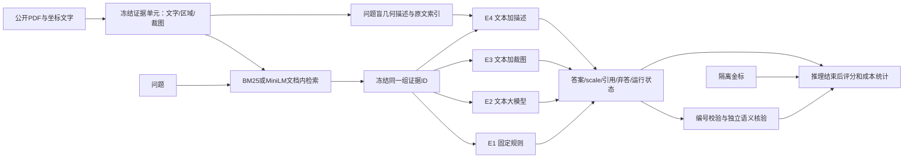

# 财报证据问答课程项目：最终完整方案

> 后续范围变更（2026-10-23）：本文件是此前保守收尾方案，现行设计为[完整流程缩量方案](FORMAL_EXPERIMENT_PLAN_SCALED_20261023.md)，此前[原大规模方案](FORMAL_LARGE_SCALE_EXPERIMENT_PLAN_20261023.md)保留历史原文。以下保留当时安排，不再作为正式实验规模依据。

版本：2026-10-23。方向：A「领域RAG问答」。对应任务书：[《自然语言处理》课程项目任务书](../../《自然语言处理》课程项目任务书.html)。最终截止为2026-10-30 24:00；内部目标是10月29日完成验收、10月30日20:00前提交。

本方案根据既有试跑确定项目范围、研究问题和收尾路线；本轮只交付方案，不启动新增实验、上传或提交。沿用用户“先不扩大样本”的决定。已有实验事实见[汇总报告](EXPERIMENT_SUMMARY_20261023.md)。这是AI协作形成的工作方案；学生须依据任务书第九节自行审定正式实验设计、撰写结果分析，并如实声明AI已经参与的环节，不能把本文件包装成独立完成的课程设计。

## 1. 题目、目标与成功判据

**最终题目：财报证据问答中的检索方法对比与视觉结构增强的适用边界。**

面向需要核对财报事实的阅读者，在给定单页财报和一个事实抽取问题时，系统检索证据，输出答案、货币／量级、证据编号及对应原文；证据不足时允许弃答。任务不覆盖跨公司全库定位、复杂算术、跨页推理、投资建议或生产部署。

研究问题固定为：

| 问题 | 比较与证据 | 能形成的结论 |
|---|---|---|
| RQ1：关键词与句向量检索有什么差异？ | 同一模型回答条件下的BM25／MiniLM；分别报告支持证据覆盖和最终答案 | 本样本的差异、错误与耗时；允许无明确优胜者 |
| RQ2：大模型回答器相对现有规则改善了什么？ | 同一检索证据下E1／E2；同时看正确率、作答覆盖和弃答 | 限定于当前规则基线，区分覆盖改善与回答能力 |
| RQ3：同范围的图像或结构描述是否提供额外价值？ | 固定检索后的E2／E3／E4；答案、单位、引用与输入代价 | 总体收益、局部现象及适用限制，允许零收益或负收益 |

项目完成的判据是：非大模型与大模型均真实运行；配对分母和控制变量清楚；至少3个课程原理点有实验证据；至少1组参数对比；至少3类真实错误归因；关键数字可追溯；干净环境按README一条命令能运行并复核结果；报告、录屏和个人贡献材料齐全。图像组胜出、显著性或固定准确率门槛均不作为预设成功条件。

## 2. 数据和固定范围

- 使用原16份单页／48题TAT-DQA英语事实抽取子集：官方train的4份／12题开发，官方dev的12份／36题试评。沿用种子42及原筛选清单，不补题、换题或按模型效果选题。
- 97个冻结证据单元绑定文字、坐标、裁图和SHA；13页局部区域，3页整页诊断。原始PDF、OCR、问题、答案、证据映射和历史输出均保留。
- 仅在给定文档内部检索；候选区域由输入文字与坐标形成，不用答案位置构造。金标只供独立评分与核验，不进入索引、描述或模型请求。
- 官方数据说明提供PDF、带坐标转换文字和问答；仓库声明数据许可为CC BY 4.0，报告保留作者、来源与许可链接。公开财报不等于任意再分发，按许可保留归属，不上传额外个人资料。[官方说明](https://nextplusplus.github.io/TAT-DQA/)／[许可声明](https://github.com/NExTplusplus/TAT-DQA#license)。
- 36题已经用于试评和本轮诊断，后续依据这些答案修改检索、规则或描述的成绩只能列为探索性结果；不得称作新的独立测试。主结论使用已冻结版本。

本阶段不增加样本或新模型。若以后另行研究改良结构表示，应使用新的独立报告验证，作为后续课题，不作为本次按期交付的依赖。

## 3. 技术路线与选型

采用已有Python核心、BM25、固定本地all-MiniLM-L6-v2和Pinaic Responses接口。BM25参数和编码器revision沿用原冻结记录；MiniLM输入截断单独披露，不把语义检索的向量截断混成回答文本截断。

E2—E4固定返回模型标识`gpt-6.1-sol`、low推理、最大2048输出token、stream=true、store=false及同一答案schema。代理底层版本未独立认证，报告按“服务返回标识”表述。E4不新增描述生成大模型。

选型理由：

- BM25用于可解释的词项匹配，MiniLM用于预训练句向量相似度比较；不预设语义检索更强。[Sentence-BERT原论文](https://aclanthology.org/D19-1410/)供表示方法背景，具体模型以项目固定revision为准。
- RAG使本题要求的原始证据与回答分离，方便显示引用、核对单位和定位失败；本项目是检索后提示回答的简化实现，不复现原RAG论文的训练系统。[RAG原论文](https://arxiv.org/abs/2005.11401)。
- 当前目标是比较证据检索和利用方式；不开展SFT／LoRA、模型训练或完整OCR／表格解析系统，避免把训练数据、模型和证据变化同时引入。
- 采用命令行演示并显示原文／裁图，无需建设网页前端、数据库或复杂应用外壳。

数据流如下；正式报告据此绘制架构图：

描述生成仅接收证据，不接收问题；图中问题只进入检索和回答。引用编号校验已有，语义支持核验是本轮收尾工作，不声称线上已经自动完成事实核查。

## 4. 最终实验矩阵与已有证据

### 4.1 四组回答实验

| 组别 | 输入 | 回答器 | 状态 |
|---|---|---|---|
| E1 | 检索证据文字 | 固定关键词／年份／金额／单位抽取规则 | BM25、MiniLM均已完成 |
| E2 | 相同证据文字 | 固定大模型 | BM25、MiniLM均已完成；BM25有同时期复测 |
| E3 | E2文字＋同区域原始图像 | 与E2相同大模型 | BM25已完成 |
| E4 | E2文字＋固定问题盲几何描述及原文索引 | 与E2相同大模型 | BM25已完成 |

不补跑MiniLM的E3／E4。基础检索比较与开发选定检索器上的四组扩展已经可以分别回答RQ1与RQ3，无需为矩阵整齐增加无关调用。

四组共同文字、证据顺序、模型、提示和生成设置固定。E3图片不能包含额外文字；E4不引入其他区域或答案推断。原图不静默缩放／裁剪，任何截断、错误、拒答或接口异常均保留。

### 4.2 主表和分母

| 固定BM25的共同32题 | 严格答案＋scale正确 | 仅答案正确 |
|---|---:|---:|
| E1 | 3/32 | 8/32 |
| E2 | 14/32 | 16/32 |
| E3 | 15/32 | 16/32 |
| E4 | 13/32 | 14/32 |

这是三组模型均正常返回的共同题集，“正常返回”包括明确弃答。32题来自11份报告：原36题减BCE3题图文范围不一致，再减1题E2／E3共同上游故障。完整共同33题另列，保留该故障；完整36题的E1／E2／E4执行情况保留。不得把故障当成模型能力错误，也不得只展示删除故障后的主表。

局部26题与整页诊断6题分别报告。旧10月21日36题BM25／MiniLM结果17/36与16/36只用于同批检索比较；本轮视觉组用本轮E2作对照，不与旧结果拼表宣称增益。

### 4.3 参数与分词对比：复用开发集真实运行

| 开发配置 | 支持证据命中／有效映射11题 | E1严格正确／12题 |
|---|---:|---:|
| BM25 finance，k=1 | 8/11 | 5/12 |
| BM25 finance，k=2 | 11/11 | 8/12 |
| BM25 simple，k=2 | 10/11 | 7/12 |
| MiniLM，k=1 | 8/11 | 5/12 |
| MiniLM，k=2 | 11/11 | 8/12 |

表中命中与完整覆盖在该开发集上数值相同，但评价中仍分成两个指标。原12题有1题证据标注冲突，没有修改原答案，因此映射指标有效分母为11。

k=1／2满足参数比较要求；finance／simple在k=2下支持分词原理点。全部明确标为开发集，不能当成新的试评成绩。收尾时从冻结检索输出选取真实排名变化案例，核对分词和top-k如何改变证据覆盖。

## 5. 必须讲清的三个课程原理点

| 课程原理点 | 本项目的实验证据 | 学生需要解释的问题 |
|---|---|---|
| ① 分词／词表对检索的影响 | 固定k=2的finance／simple覆盖11/11对10/11及真实排名案例 | 财务数字、缩写、连字符等如何影响词项匹配？变化是否只限于本子集？ |
| ⑨ RAG的证据覆盖限制及引用校验 | k=1／2差异；三组共同弃答的3题；引用语义核验 | 答案在原页上，为什么检索后仍无法回答？编号存在为什么不等于引用支持答案？ |
| ⑩ 指标与评价协议 | EM／F1、18道数值题及单位诊断；32／33／36题分母；两次E2批次 | 为什么空格、片段边界与单位会使指标产生不同判断？为什么需要同批配对？ |

三个点都使用现有数据和输出，不以只讲注意力、Transformer或大模型概念凑数。BM25／MiniLM的表示方法比较作为补充，不要求得出某模型必胜。

## 6. 评价与引用核验

保留冻结自定义评分器，明确“非官方TAT-DQA”。不为改善分数替换金标或事后放宽主指标。

| 层次 | 固定评价内容 | 分母与解释 |
|---|---|---|
| 检索 | 至少命中一处支持；完整支持覆盖 | 各自使用有效且已核验映射；不是穷尽语义Recall |
| 回答主指标 | 严格EM、严格token F1 | 指定共同题集的全部题，弃答和执行状态另列；不能误用仅已回答题分母 |
| 回答补充 | 仅答案EM／F1、作答覆盖、弃答率 | 保留货币／百分号，解释片段形式差异 |
| 数值诊断 | 数值相等；数值与货币／百分号／量级一致 | 可解析的同一18题；不得冒充全题准确率 |
| 引用 | 编号有效；所引证据实际支持答案 | 作答记录逐条标注，空引用、部分支持与无法判定单列 |
| 工程 | 调用数、输入／输出token、耗时、错误、价格与费用 | 区分主比较、开发／排错和复用；不重复计费量 |

当前18题数值正确均为18/18，数值与单位一致为E2的15/18、E3／E4的17/18。该指标是既有数值诊断的补充汇总，不替换严格分数。共同32题平均输入约752／1466／2263 token；单请求耗时中位数约5.35／10.55／5.60秒，服务负载未隔离，只说明本次观测。

**引用核验操作规则：**

1. 对主报告所引用批次的所有作答记录核对引用，包括当前BM25四组和旧批MiniLM／BM25检索比较；弃答与接口错误单列。答案与引用证据集合完全相同的记录可复用一次核验，并保留引用关系。
2. 核验者只依据题目、模型答案、所引区域和原页判断，先不看该组总分。标记“支持／部分支持／不支持／无法判定”，并保存对应原文或区域定位及理由。
3. “支持”要求证据共同支撑答案、年份／指标及单位，不用金标强迫其判为支持。需要未引用区域才能支持的，不能记为引用支持。
4. 一人初核，另一人复核全部非“支持”项及争议项；保留最终判据、分歧和核验覆盖数。正式报告由学生完成核验与解释。
5. 报告每组作答数、提供引用数、核验数、支持数和各异常类别。语义支持率以所有作答记录为基础单列，缺引用或无法判定不能静默从分母消失；证据映射不完整与模型引用错误分开记录。

不进行小样本“显著更优”的宣称。不同问题来自同一报告，不能把每题都当作独立材料；新模型／新提示的探索也不能与原冻结结果混为同一实验。

## 7. 错误分析与展示案例

至少完成以下三个已真实出现的类别，每类记录问题ID、选中证据、正确证据位置、输出、评分变化、原因与可修复方向。若语义核验未发现某类错误，报告零例，不制造错误。

| 类别 | 已有案例 | 归因边界 |
|---|---|---|
| 检索／区域关联遗漏 | 腾讯投资业务说明在下一块；Other external purchases脚注③和Customer related costs脚注②未取回 | 三组相同3题弃答，证据未送到回答器；不写成大模型不会理解 |
| 单位／量级遗漏 | `24,264`对应thousand但输出scale为空；E2复测`2,493`缺million | 数值正确不代表单位正确，属于回答信息不完整 |
| 输出片段／评分形式差异 | `$213,654`与`$ 213,654`；答案省略where | 展示原分数与语义解释，不能一律当事实错误，也不临时修改评分器 |

另将BCE图文范围不一致、代理上游错误列为数据与工程限制。它们不能充作三个模型错误类别，也不能据此声称模型能力下降。

原3题弃答应作为“RAG证据覆盖限制”的主难例。可在演示中显示原页有答案、检索却漏掉脚注的过程。若以后修复相邻块／脚注关联，另存v2并标探索性，不覆盖本次冻结主结果。

## 8. 收尾实现、产物与验收任务

以下均是后续待执行任务；表内拟新增入口不是现有可运行命令。本方案不修改冻结`src/`和旧运行源码快照，外围工具放在`scripts/`，新输出使用新目录。

| 任务 | 使用／拟新增的文件 | 交付与验收 |
|---|---|---|
| A. 最终证据清单 | 沿用`artifacts/llm-phase3/RESULTS.json`、`artifacts/llm-phase4/RESULTS.json`、`summary-diagnostics.json`；拟新增`docs/COURSE_EVIDENCE_INDEX.md` | 每张正式结果表可定位到输入、批次、源码／模型、逐题输出、分母和SHA；旧数据零覆盖 |
| B. 引用与错误核验 | 拟新增`artifacts/course-validation/citation-review.jsonl`、`citation-summary.json`、`error-cases.json` | 采用第6节判据；所有报告批次作答引用均有记录，至少3类真实错误，双人复核分歧 |
| C. 统一复现入口 | 拟新增`scripts/course_entry.py`、`tests/test_course_entry.py`，更新README现行部分；保留历史说明 | 提供verify／run／demo三种明确模式；参数化资源目录与输出目录，不能依赖原作者绝对路径 |
| D. 课程提交清单 | 拟新增`docs/COURSE_SUBMISSION_MANIFEST.json`及独立课程打包入口／测试，不改变原私有快照清单 | 一个≤50MB的ZIP，禁入数据、权重、视频、密钥与环境；从解压包在新路径完成验证 |
| E. 正式材料 | 由学生完成报告PDF、300字内摘要、≤2分钟录屏、每人贡献声明和AI声明 | 任务书第八节八节结构；报告数字、视频行为、个人贡献与代码／日志一致 |

复现模式应明确区分：

- **verify：结果复核。** 取得外链资源后，一条命令校验SHA并重新计算冻结输出的主表、参数表、诊断表；无API调用、不冒充模型重新生成。迁移后的路径映射写在外层，不改写旧文件及其SHA。
- **run：真实执行。** 一条命令执行数据准备／检索／回答／评分流程；标准库核心与MiniLM依赖分层安装，模型固定revision。真实大模型需环境变量密钥并记账；不得默认付费、重置账本或把缓存回放写成新推理。代理生成结果可能不同，应保留新输出而不是要求逐字复刻旧答案。
- **demo：实际系统演示。** 使用真实题目运行检索并显示证据，展示正常抽取和漏脚注弃答各一例；如显示缓存响应，画面标明回放。最终视频至少包含一次真实回答器调用，单独demo job记账，不进入主比较。

新的入口须有针对性验证：新路径运行、缺资源给明确定位信息、无密钥不发请求、verify不联网、旧数据篡改被拒绝、打包禁入项被检测。当前101项测试98通过、3项PDF可选依赖跳过只是历史软件状态；正式干净环境验收要实际运行所需PDF与编码器依赖，不能把跳过记为通过。

**迁移和环境要求：** 当前封存job含绝对路径、README还保留旧Linux运行环境，尚未达到课程干净环境一键验收。通过外围路径适配和固定资源清单解决，旧封存输出不改。以CPython 3.12的独立CPU环境验证锁定依赖，记录实际OS、版本、模型SHA和完整命令；不要把Linux CPU依赖锁未经验证当成macOS通用锁。首次下载所需网络与资源大小写清楚。

## 9. 调用与费用安排

已有185/200次尝试；本方案不增加主矩阵或批量重跑。保留剩余最多15次用于最终真实演示及明确的接口验证，所有新尝试继续记入原全局账本，失败不退款计数。必要演示2次以内，失败原因检查后最多一次重试；触及200次立即停止，不更换账本绕过限制。

外部接口只上传选定的公开材料，不上传学号、姓名、个人贡献文件或密钥。录屏中的身份信息只用于课程要求，不作为模型输入。最终工具从环境变量取密钥，密钥不得进入源码、ZIP、图像或日志。

**费用是当前真实缺口：** 组长从所用Pinaic渠道后台取得实际费率或账单，按真实输入／输出／缓存／图像等计费规则写明模型、调用量、单价、估算与实际账单区别。已有失败与无usage记录不可伪造token。没有渠道费率时不套用OpenAI官方价，不把费用写为0；该任务必须优先补齐，仍无法核实则如实标为未满足项，不能宣称成本材料已完整。

## 10. 正式报告、图表和录屏

正文目标**10页**，满足8—12页（附录不计）；按任务书固定八节写作，图表计入对应章节。

| 八节结构 | 页数目标 | 必须承载的本项目内容 |
|---|---:|---|
| ① 问题定义与背景 | 0.75 | 给定财报事实抽取、用户、范围、RQ1—3与成功判据 |
| ② 相关工作与方案选型 | 1.0 | BM25／句向量／RAG／视觉输入；为什么用证据检索、为什么本阶段不微调；引用原始论文与官方数据说明 |
| ③ 系统设计 | 1.0 | 架构图、证据单元、金标隔离、四组数据流、引用核验职责 |
| ④ 实现细节 | 2.0 | 证据裁图与冻结、分词与编码器截断、API／流式／schema、跨路径复现；展示真实问题与修复证据 |
| ⑤ 评估 | 2.5 | 数据划分和许可、三层分母、四组主表、两检索器表、开发k值／分词表、数值单位与成本表 |
| ⑥ 错误分析与局限 | 1.5 | 至少3类逐题案例；脚注遗漏、单位、输出边界；小样本、整页诊断、描述重复与模型批次差异 |
| ⑦ 工程与伦理 | 0.75 | 实际费用、延迟、资源／密钥、数据许可、AI声明与人工验证 |
| ⑧ 分工与贡献 | 0.5 | 实际责任、输出文件与证据，和每人声明一一对应 |

必要图表为：一张架构图；一张方法／输入矩阵；四组配对主表或带分母柱状图；检索与开发参数表；至少三类案例图表；token／延迟表。正文优先合并相近表，原始逐题输出放外链。项目不训练模型，不补造loss曲线。

录屏脚本控制在115秒以内，预留5秒余量：0—10秒显示成员本人学号、姓名、题目；10—45秒真实运行正常题，显示检索证据、答案、单位与引用；45—85秒展示漏脚注难例、证据不足弃答；85—105秒运行结果复核入口并显示四组表；105—115秒说明一项真实限制。先完成真实演示与链接可访问核查再交付，绝不把预录文本或JSON截图伪装成实时调用。

摘要不超过300字、不含图表，由学生写明问题、方法、具体配对分母下的主要数字及结论。不要把17/36、15/32和13/32拼成同一批结果。

## 11. 个人分工和时间表

采用三个责任模块，按真实组员分配而不虚构姓名或工作量：

| 责任模块 | 主要任务 | 个人产出证据 |
|---|---|---|
| 数据与检索负责人 | 数据与许可、证据单元、BM25／MiniLM、k值／分词对比、检索错误复核 | 来源清单、版本与运行日志、开发参数表、脚注案例 |
| 回答与复现负责人 | 四组协议、API与密钥、统一入口、环境与迁移、演示 | 新入口和测试、运行记录、真实演示、费用与token清单 |
| 评估与材料负责人 | 统一分母、数值指标、引用初核与复核协调、图表和报告整合 | 评分核验记录、引用表、错误归因、报告／摘要／AI声明 |

2人组由第一人承担数据与检索、第二人承担回答与复现，双方共同承担评估与材料并交叉复核；4人组把“评估核验”和“报告／交付整合”分开。组长从实际组员中确定，负责最终核查与提交。每人亲自完成贡献声明并互相确认，不按角色名称推算或编造个人已经做过的工作。

| 日期 | 完成目标 | 退出条件 |
|---|---|---|
| 10月23—24日 | 学生审定本方案；冻结选题、主表、证据索引与分母；查明渠道账单 | 研究问题、三原理点、费用来源和责任分配明确 |
| 10月24—25日 | 完成引用语义核验、三类错误与开发参数案例整理 | 作答记录均可查核验结果，分歧有结论；不新增调参 |
| 10月25—27日 | 完成统一入口、环境／路径适配和课程打包清单 | 新目录能复核表格、真实执行入口有验证记录，秘密及数据禁入检查通过 |
| 10月27—28日 | 学生完成八节报告、摘要、AI及个人声明；录制演示 | 关键数字均有来源，视频≤2分钟且身份／难例清楚 |
| 10月29日 | 从最终ZIP解压到全新目录验收，检查全部外链 | README一条命令可运行；报告／代码／日志一致；总包≤50MB |
| 10月30日20:00前 | 组长提交，保存回执并核对最后版本 | 最迟不超过任务书10月30日24:00；不等待最后时刻 |

日程是后续安排，不表示任务已执行；未创建自动化或提交任何材料。

## 12. 提交包及外链资源

只提交一个ZIP，命名为实际组长学号、姓名和项目名组成的`学号_姓名_项目名.zip`。内容包括：报告PDF、`项目摘要.md`、README、全部项目源码与外围脚本、必要测试和依赖说明、每人一份贡献声明，以及不含原始数据的聚合指标／来源清单。AI声明放报告附录。源码不能只打包`src/`而漏掉`scripts/`执行器。

以下内容均放有权限说明、可访问并带SHA的外部资源链接：原始与处理后数据、PDF／OCR／裁图／金标、模型权重、完整模型请求与逐题响应、完整评分资源、录屏。完整请求中可能嵌有图片／原文，不能因为后缀是JSON就混进课程ZIP。必要的少量报告案例摘录可随报告保留，不能把完整子集改名为日志绕过“数据不进包”。

原`docs/PACKAGING_MANIFEST.json`及`financial-rag-nonllm-verified.zip`是包含数据的私有工程快照，必须原样保留，不直接作为课程提交包；另建课程清单和新ZIP。外链资源由组长在取得合适上传权限后整理，不在本轮自动上传。

**最终逐项验收清单**

- [x] 非大模型基线与大模型方案及真实对比记录存在。
- [x] BM25上的E1—E4、两检索器E1／E2与开发参数比较已经运行。
- [x] 固定数据、输出、评分和独立重算证据已保留；原样本不扩大。
- [ ] 学生审定最终问题、成功判据及三个原理点的解释，完成正式结果分析。
- [ ] 引用语义核验完成，至少3类真实错误可追溯。
- [ ] 渠道实际费率／账单及费用说明补齐。
- [ ] 全新环境与新路径按README一条命令运行，复核与真实执行明确区分。
- [ ] 最终正文8—12页且八节齐全，架构图、参数对比及真实案例完整。
- [ ] 摘要≤300字；每人贡献声明、AI声明与实际证据一致。
- [ ] 录屏≤2分钟，真实运行、至少一例难例，画面有本人学号姓名。
- [ ] 所有外链可访问，数据／模型／视频／密钥／环境未进入ZIP，总体≤50MB。
- [ ] 最终包从新目录验收后由组长按时提交，保存最后版本与回执。

评分对应：选题5分靠明确RQ与边界；进度5分靠既有真实记录与收尾证据；源码12分靠新环境一键运行；评估12分靠配对指标、三原理点、三类错误和参数比较；报告录屏6分靠完整材料；贡献5分靠每人的真实产出。以上是工作覆盖关系，不预测或保证最终分数。
