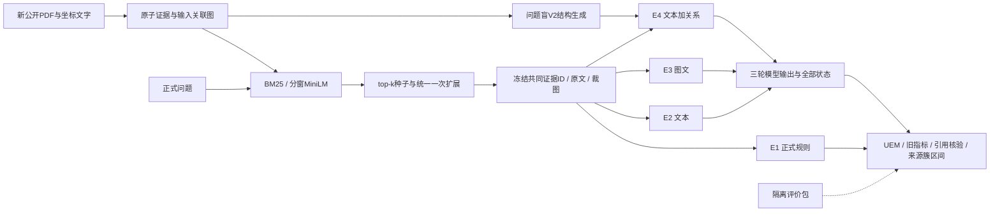

# 财报证据问答：完整流程缩量实验方案

版本：2026-10-23，缩量修订。依据用户要求，只调整样本、审核样本和资源数量，保留全部实验条件、三轮重复、对照、统计与课程交付流程。原[大规模版本](FORMAL_LARGE_SCALE_EXPERIMENT_PLAN_20261023.md)保留历史原文，本文件为现行方案。

版本日期：2026-10-23。课程方向A「领域RAG问答」。任务书：[原始HTML](../../《自然语言处理》课程项目任务书.html)。本文件取代此前面向48题的保守收尾方案，规划一套新的正式实验；本轮没有下载新材料、运行新模型或提交任何课程文件。

**规模目标：开发50题＋验证50题＋独立主测试200题，另加50题结构诊断，共最多350道新题；两种检索器完整覆盖E1—E4，生成条件各做3轮重复，另有消融、证据对照、参数实验和第二模型。计划正式推理6,600次，整个新阶段最多8,000次尝试。**

现有48题只作预实验与开发依据，不能再进入正式测试或与新测试成绩合并。旧200次上限属于预实验；本方案使用新的阶段预算，保留旧185次历史账本，不清零、不覆盖。用户本轮要求制定方案，不代表这些新调用已经启动。

本文件是AI协作形成的研究与工程提案。按任务书第九节，学生须审定正式设计、承担结果解释与写作、如实披露AI已经参与的环节；不能把本文件包装成学生独立完成的正式实验设计或把拟议工作写成已完成。

## 1. 研究定位与预实验依据

**最终题目：财报证据问答中的检索、视觉与结构表示：配对实验及收益机制分析。**

任务是在给定英语单页财报和原始事实抽取问题时，检索证据并输出答案、量级和可追溯引用。保持单页、原标注span事实抽取，不扩展复杂算术、跨页推理或跨公司全库定位。规模扩大、完整对比与机制分析是正式阶段的重点；不以堆积模型或新增训练任务充当实验规模。

预实验支持技术链路可运行，并暴露了正式设计必须处理的风险：

| 已有证据 | 正式实验的对应改进 |
|---|---|
| 共同32题E2／E3／E4严格正确14／15／13，只有少数题变化 | 新的200题独立主测试、3轮重复、报告来源分组区间估计 |
| 18道数值题均读对数值，单位诊断15／17／17 | 将数值、货币、百分号、量级分开评估；加入更依赖结构的独立诊断题 |
| E4重复原文且主要描述块间上下位置 | 主E4改为可核查的行／列／表头／单位关系，设置纯重复和无关系索引对照 |
| 三组共同弃答3题，缺少相邻段落或表格脚注 | 增加问题盲的段落完整性与脚注关联，再用关闭关联的实验核对收益 |
| MiniLM曾截断长候选证据 | 正式R2采用固定分窗检索，不静默截断长证据 |
| 单次代理输出与故障会改变分数 | 轮次配对、交错运行、独立错误状态、统一重试及全样本主分析 |

这些证据支持开展正式研究，不预先证明新E4可用、图像必然提升或某检索器更好。以下算法、规模、人工核验和统计流程都尚待实际执行。

## 2. 研究问题与预注册主对比

四项主对比均在200题主测试集、固定主模型上预先声明，主终点为第7节的单位感知规范匹配准确率（UEM）：

| 编号 | 固定对比 | 回答的问题 |
|---|---|---|
| P1 | BM25＋E2 − BM25＋正式E1 | 相同证据下，大模型相对认真实现的传统抽取基线改善多少？ |
| P2 | MiniLM＋E2 − BM25＋E2 | 回答器相同时，检索表示如何影响最终结果？ |
| P3 | BM25＋E3 − BM25＋E2 | 同范围图像是否有额外收益？ |
| P4 | BM25＋E4 − BM25＋E2 | 显式结构关系是否有额外收益？ |

BM25作为P3／P4的固定参照，避免看验证或测试结果后挑更有利的检索器。完整矩阵中MiniLM的视觉／结构效应、两检索器与增强方法的交互、题型差异和第二模型作为预先声明的次级分析。E1不被刻意保持弱覆盖以衬托大模型。

本方案选择**绝对5个百分点**为主准确率的工程实用收益门槛，用于解释额外输入成本是否值得；这不是统计定律或普适经济阈值，须在开测前确定，开测后不改。正式研究允许得到稳定正收益、实用等价、负收益或仍不足以判定；不得将“组别必须胜出”写成成功条件。

## 3. 数据规模、来源划分与防止泄漏

### 3.1 已核对的候选容量

本轮只机械统计既有候选元数据，没有读取新问题／答案内容、下载新PDF或选出正式QA。排除原16份试跑、早期3份材料及UMC材料等共20个已接触来源键后：

- 剩余150个归一化公司／报告来源键、1,651个元数据单页候选。
- 每页最多3题时，元数据层面有3,840题容量；这还不是实际图文核验后的可用数量。
- 官方train／dev的原财报来源有119个重叠。直接沿用官方划分不满足本项目报告来源隔离，因此合并可用train／dev元数据后重新按来源组划分，并保留原split字段；结果称为自定义报告隔离基准，不冒称官方测试集成绩。
- 初步来源键是文件名去扩展名、大小写归一及末尾年份；还须检查公司别名、PDF／页面SHA重复。已接触公司有其他年度报告时一并排除。

输入计数、来源SHA、划分规则和预算算式见[规划核对记录](../artifacts/formal-plan-20261023/scaled-plan-checks.json)。数据许可与字段依据[官方说明](https://nextplusplus.github.io/TAT-DQA/)及[仓库许可](https://github.com/NExTplusplus/TAT-DQA#license)，正式材料保留CC BY 4.0归属。

### 3.2 正式划分与用途

对完成别名与去重核验的来源键排序，使用种子20261023打乱，前30组开发、后30组验证，其余约90组为测试候选来源池；沿固定随机顺序取40个合格来源用于本次测试，其余只作开测前资格不足时的顺序候补。当前元数据容量检查如下：

| 集合 | 目标题数 | 来源组数 | 元数据题目容量（每页≤3、每来源≤20） | 用途 |
|---|---:|---:|---:|---|
| 开发 | 50 | 30 | 428 | 实现规则、结构解析、提示与评价测试 |
| 验证 | 50 | 30 | 472 | 选择一次最终配置，检验服务、代价和结构质量 |
| 主测试 | 200 | 目标40，实际至少20且至多50 | 前40来源与诊断合计容量498 | 四项主对比和完整主矩阵 |
| 结构诊断 | 目标50 | 仅取本次测试来源 | 与主测试不重复QA | 复杂表头25题、脚注／注释关联25题的次级研究 |

同一公司／原报告及重复页面不得跨开发、验证、测试。测试主集与结构诊断集共享测试来源，后者不是第二个独立公司样本，不能当作独立复现。

每页全部正式集合合计最多3题，每个来源在所属角色中最多20题。主测试先确保各有效测试来源有题，再按预定随机顺序补足；这是有来源覆盖约束的随机基准，不宣称代表全部原始财报分布。开发与验证同样受限随机抽取。

来源池30／30／90的隔离规则、种子与顺序不变，仅缩小实际测试使用的来源数量以匹配题量。首40个测试来源共有374个元数据单页候选，在每页≤3题、每来源≤20题限制下容量498；这是元数据容量，不是已通过图文资格核验。主测试覆盖全部本次选定的有效来源；辅助S50同样先覆盖它们，因此实际有效测试来源不得超过50。目标40来源未满足时，沿预定候补顺序替换；任何降至20—39来源的情况均须开测前记录，少于20则修订方案。

结构诊断题根据原页及问题的结构依赖判断选入，不看模型表现：复杂表头题需定位多级／跨列／跨行表头关联；脚注题需把指标与注释内容或说明关联。筛选员不制作答案解释，也不修改原题。诊断集若不足50题，只报告实际合格数量，不用普通题充数；核心200题不因此改成小规模试跑。

**正式启动门槛：** 实际下载、去重和同范围核验后，主测试须达到200题、至少20个独立来源键（目标40，最多50）、每页≤3题。无法达到时必须在任何测试生成前修订设计并明确回报，不能把预实验或未核验候选冒充正式样本。容量检查说明目标有候选依据，不保证所有候选都能通过后续核验。

### 3.3 测试隔离

- 数据保管员生成只含问题和输入的推理包，答案、推导和支持映射留在独立评价包。
- 规则／提示／结构算法开发者只接触开发与验证QA；冻结后由调度器读取测试问题。测试答案不进入索引、描述、模型请求或运行排错日志。
- E4生成及图文核验者只看输入区域和元数据，不能看对应问题、答案或模型输出。
- 测试前预注册样本清单、主对比、辅助子集、指标、配置、代码及模型返回标识。测试中不按成绩调整样本量、不挑错题修补。

## 4. 证据单元、检索与传统基线

### 4.1 新正式证据版本

原预实验数据保持冻结，正式数据使用新版本和新路径。先建立完整段落／表格／注释原子单元及问题盲关系图，重点修正“原句被切在相邻块”和“表格标签与脚注分离”的问题：

1. 依据阅读顺序、行位置与段落边界合并明确的句子续接，歧义不合并；表格保留标题和表头。
2. 仅依据原页中的脚注标号、标题、坐标建立关联，不依据问题、答案或模型失败位置建立连接。
3. 两检索器先在同一原子候选集取相同top-k，再按同一规则扩展一次明确关联的注释／续接单元。去重后冻结实际送入回答器的证据集合。
4. 表中k表示初始检索种子数；扩展后实际单元数、输入长度及覆盖率另外记录。原始召回与扩展后覆盖分开报告。
5. 每个送入单元绑定原文、坐标、裁图、ID和SHA。矩形裁图若包含额外文字，须在建库前并入该单元共同文字；不得只让E3得到更多事实。

自动校验覆盖全部单元；对实际入选测试页面进行逐页、问题盲的图文范围核验，疑似额外字／漏字／裁切的单元逐一确认。单位与范围无法确认的样本在生成前按预定候选顺序替换并记录原因，所有条件同步排除。整页降级单列，不称为局部证据收益；同时披露局部／整页占比和候选数分布。

E4未识别出结构不构成样本排除理由。描述覆盖率是方法表现的一部分，不能只保留E4成功解析的题。正式所有条件须容纳相同共同文字；超预算资格检查在抽样冻结前完成，不在推理中静默截断。

### 4.2 两种检索器

- **R1：BM25 finance**，主条件固定k=2、k1=1.5、b=0.75；词项处理版本固定。
- **R2：all-MiniLM-L6-v2**，沿用已记录的固定模型revision，384维、mean pooling、余弦。长单元按编码器tokenizer分窗：窗口192 token、步长160，各窗分别编码，单元得分取最高余弦，不将长单元静默截为首256 token。特殊token与查询长度在开发阶段验证。
- 候选单元、top-k、关联扩展、并列排序和回答模型一致。长块分窗是正式R2的已声明组成，不与旧MiniLM首段截断结果混成同一版本。
- k=1／2／4以及finance／simple只作为预注册的参数／分词比较，不看主测试选择赢家；主矩阵始终使用k=2。

### 4.3 正式E1

正式E1使用有限、可解释的词项／句子评分、年份／指标匹配、数值与单位模式、行列邻近关系和置信阈值。E1只从共同文字已有换行／制表符判断邻近，不读取E4关系或原始图像，避免额外输入混杂。不使用生成大模型，不逐题写规则；阈值按验证UEM最高选择，同分时优先更少无依据作答、再优先更简规则，随后冻结。不能唯一确定时弃答，报告覆盖—正确率，不能通过强制输出掩盖错误。

旧E1也在新数据上运行，作为“旧规则→正式规则”的辅助表，不计API调用。P1以正式E1为参照，避免故意用过弱基线制造大模型优势。无论E1是否改善，都如实保存两版本。

## 5. E2—E4及结构表示设计

### 5.1 回答模型和共同协议

主模型M1沿用已验证链路的`gpt-6.1-sol`；次模型M2预定`gpt-6-astra`。官方模型页列出二者支持文本／图像、Responses及结构化输出：[M1](https://developers.openai.com/api/docs/models/gpt-6.1-sol)、[M2](https://developers.openai.com/api/docs/models/gpt-6-astra)。代理对M2的实际图文路由尚未验证，开发期先做兼容性测试，不以测试准确率决定换模型。

同一模型内保持相同系统指令、回答schema、low推理、最大2048输出、stream=true、store=false与图像detail=high。只依据提供证据回答，保留答案必要的货币、百分号和上下文单位，输出答案、scale、证据ID及弃答字段。开发期确定一次提示，不沿用预实验“强制去掉years”等已知可能影响原文片段的指导；所有正式组同步使用最终提示。

返回标识与使用量逐次记录；代理底层版本无独立认证，不能声称精确复现厂商内部权重。若M2无法通过图文／schema兼容性，跨模型实验应标未完成；不能在测试看分后寻找有利的替代模型。

### 5.2 四组核心条件

| 组别 | 输入／算法 | 目的 |
|---|---|---|
| E1 | 冻结证据文字＋正式规则 | 非大模型基线 |
| E2 | 冻结证据文字＋M1 | 文本RAG参照 |
| E3 | E2文字＋完全同范围原始裁图＋M1 | 图像额外收益 |
| E4 | E2文字＋问题盲结构描述V2＋M1 | 显式关系额外收益 |

### 5.3 E4 V2：从块间方位改为可使用的关系

对同一输入区域，使用文字行、词坐标和表格几何生成短编号节点与关系：

- 节点索引：`C1: 原文文字`，只使用共同文字中确实出现的字词，不添写事实；模型输入不用长UUID充当可读结构。
- 关系：数值单元格属于哪个行标签、位于哪些表头下、受哪个原文单位标题约束，以及表格条目对应哪个明确脚注。
- 多级表头保存可确认的层级链。仅在几何与文本归属能唯一确定时产生关系；歧义写“未确定”或不发出该关系，绝不生成“本题应取某值”。
- 数值不计算、不转换、不推断；输出结构不访问问题或金标。每个单元只生成一次，跨问题和轮次复用同一描述。投影到当前冻结证据集合时，任何引用未选节点或字词的关系都不得进入E4；若表头或单位在集合之外，应由所有组共用的建库／关联规则处理，不能只在描述中补入。
- 正式E4包含“节点索引＋关系”；生成失败或无可靠关系的单元仍保留在所有组，标记覆盖率，禁止按E4能力筛测试题。

V2是待实现的新方法，不能用旧几何模板已核验来宣称它已可用。开发／验证阶段对盲抽关系做核验：观察正确率至少95%，验证集表格单元至少60%有可核查的非平凡关系，作为工程启动条件；这些门槛不等于总体统计保证。测试关系只审计、不按题修正；额外报告覆盖率、误关联类型和描述长度。

## 6. 完整实验矩阵与调用量

### 6.1 核心矩阵

在主测试200题及结构诊断50题上，分别运行两检索器的E1—E4。E1每个检索器确定性运行一次；E2—E4各做3轮真实生成。

| 项目 | 每个检索器 | 两检索器合计 |
|---|---:|---:|
| 主测试生成 | 200题×3种生成条件×3轮=1,800 | 3,600次 |
| 结构诊断生成 | 50题×3种生成条件×3轮=450 | 900次 |
| 正式E1 | 250题×1次 | 500条，无API |
| 旧E1参照 | 250题×1次 | 500条，无API |

核心共4,500次生成。主200与诊断50始终分开统计，不能把难例集与受限随机集直接混成更有利的总分。诊断不足50时按真实题数重算调用量并保留原目标说明。

### 6.2 固定辅助子集S50

在看到模型输出前，从主200题抽取S50：先覆盖主测试中每个有效来源至少1题，再按预定种子补足50、每来源最多4题。辅助对比均固定BM25，除k值研究明确包含两检索器外不再选择有利检索器。该子集带来源覆盖约束，辅助结论限定于该子集；不是第二独立测试。

| 实验 | 新条件与隔离目的 | 计算 | 新生成 |
|---|---|---:|---:|
| D：纯重复文字 | 在E2后原样重复一次证据文字，不重复问题 | 50×3轮 | 150 |
| L：索引无关系 | 与E4完全相同节点索引，去掉所有关系；E4−L隔离显式关系包的作用 | 50×3轮 | 150 |
| G：旧块级几何 | 预实验式块级上下／左右描述与原文索引，比较整套表示版本 | 50×3轮 | 150 |
| I：仅图像 | 同一证据ID／裁图，不提供证据OCR文字；检验文字是否已覆盖图像价值 | 50×3轮 | 150 |
| C0：无证据 | 只给问题，保持证据约束提示 | 50×3轮 | 150 |
| C1：全文文字 | 原页全部转换文字；区分检索遗漏与证据已充分时的回答问题 | 50×3轮 | 150 |
| k值回答实验 | 两检索器E2的k=1和4；k=2复用核心同轮输出 | 50×2检索器×2额外k×3轮 | 600 |
| 关闭关联扩展 | 保持BM25种子不变，不追加脚注／续接，再做E2 | 50×3轮 | 150 |
| 第二模型 | M2的E2／E3／E4，同一证据、同一schema和3轮 | 50×3条件×3轮 | 450 |
| **辅助合计** | 不新增辅助问题 | | **2,100** |

总正式生成为4,500＋2,100＝**6,600次**。另对开发／验证运行两检索器k=1／2／4、BM25两分词、MiniLM首段／分窗的检索指标，均为本地计算；在主测试也运行已预注册的检索参数表，不用测试表选择主配置。

解释限制：D只估计增加一次原文的效果，不宣称严格token长度匹配；L与E4控制了节点索引，关系加入必然增加长度，结合D和实际token量判断信息价值。G比较整个旧／新表示方案，不能单独归因于粒度。C0检验给定证据约束下的行为，不是一般知识能力测试。C1是全文参照，不是保证更高的理论上界。第二模型只检验跨模型一致性，不能推出所有模型都适用。

## 7. 指标与冻结评价协议

### 7.1 主指标：单位感知规范匹配UEM

预实验说明货币空格和scale会使解释困难，正式主指标在测试前定义，不对旧实验追溯改分：

1. 所有答案先做NFKC、大小写和空白归一；仅规范货币符号／符号与数字之间的空格，不删除货币、百分号、正负号、语义词或量级。
2. 原金标可解析为单一数值时，使用已有数值诊断思想，比较Decimal数值、货币、百分比属性和有效量级，检查字段与行内量级冲突；不把5与5%或千与百万当作同一答案，不做任意单位换算，也不把含义可能不唯一的`$`自动替换为USD。
3. 非数值span采用固定规范化的片段精确匹配，忽略原规则已忽略的句末标点，不将同义表达或省略where自动判等价。scale仍须匹配。多span若存在，按原顺序逐段匹配，不将其当作多个备选正确答案。
4. 模型弃答、拒绝、解析／截断错误和最终接口失败在全样本端到端UEM中记0，状态另列；这是系统结果，不把技术故障解释成模型理解错误。
5. 测试之前用开发／验证建立单元用例：货币空格等价、缺货币不等价、5与5%不等价、量级冲突不等价、正文关键字删减仍不匹配等。规则文件、用例和版本随预注册冻结。

UEM仍是严格规范匹配，不冒充全面语义正确率，也不是官方TAT-DQA指标。旧自定义严格EM／F1和仅答案EM／F1作为并列辅助指标保留，展示结论是否依赖评价口径；不得在看到正式测试后挑有利指标作为主指标。

### 7.2 必要补充指标

| 层次 | 指标 | 关键口径 |
|---|---|---|
| 检索 | 初始支持命中、扩展后支持命中、完整支持覆盖、排序及候选数 | 自动映射只是诊断；人工核验子集另列，不能叫穷尽语义Recall |
| 回答 | UEM、原严格EM／F1、仅答案EM／F1、作答／弃答率 | 全部主200题为主分母；不使用仅已回答题准确率冒充总体 |
| 数值 | 数值、货币、百分号、有效量级、冲突率 | 同一预先固定的可解析金标子集；报告其题数 |
| 引用 | 编号存在、是否共同支持答案及单位 | 自动全量；语义核验按固定随机子集估计 |
| 结构 | 关系覆盖、关系正确率、歧义／错误类型、单位及表头关系覆盖 | 无关系也计入覆盖分母，不筛掉E4失败 |
| 工程 | 输入／输出／缓存／图像usage、耗时p50／p95、调用与失败、费用 | 主／辅助／开发／重试分别记账，代理真实费率 |

### 7.3 人工语义核验与错误分析

- 主200中用独立种子均匀抽S30；核验其第一轮两检索器×E2—E4，共180条潜在作答记录。结构诊断另随机抽15题，只核验BM25三生成组第一轮，最多45条；两部分分开估计，不混成总体支持率。
- 相同答案与同一引用证据集合允许复用一次核验，保留复用关系；弃答／失败、空引用和无法判定均保留状态，不能从支持率分母静默删除。所有轮次均做自动编号检查。
- 学生核验者看到题目、答案、所引证据和原页，但对模型／组别名和总分遮盲。标“支持／部分支持／不支持／无法判定”及理由；第二人独立复核随机25%及全部争议／非支持项，报告分歧和最终裁定，不把这些比例冒充全量语义审核。
- E4关系另盲抽30个区域，按关系类型抽查每区最多5条，核对表头／行标签／单位归属。该核验不提供问题、答案或输出；测试关系错误不按题修复，不据此删除E4样本。
- 对所有不一致答案自动聚类，再由学生审阅代表案例，至少区分：检索遗漏、表头／行列错配、单位与货币错误、无依据回答／引用错误、输出格式／金标歧义、数据与接口故障。未出现的类别报告零，不为达到数量编造案例。

## 8. 重复运行、统计与能证明的范围

### 8.1 三轮真实重复

每个生成条件做3轮独立请求，固定轮次1／2／3。API支持seed时记录实际生效值；不支持时不伪造可控随机种子。主点估计先对同题三轮正确分数取平均，再对题目取平均，不用最好一次、投票或pass@3提高主分数。

重复轮次不是新增独立题：200题×3轮仍是200个问题、目标40个来源簇，不写成600个独立样本。单独报告各轮结果与波动；主区间反映在已观测三轮平均下的来源不确定性，不声称完全估计了所有生成随机性。

每轮按固定随机顺序交错运行两检索器和各输入条件，避免先跑完文本再隔很久跑视觉。完全相同模型、题目、完整输入及轮次在两检索器间相同时可复用同一真实响应；不同轮次不得缓存复用。6,600是未计复用收益的调用预算。

### 8.2 区间与主对比家族

以归一化公司／报告来源为簇，成对bootstrap 10,000次，条件间始终使用同一重采样簇；每簇保留其所有题及三轮平均，报告绝对正确率差。附公司等权宏平均作为敏感性分析，主指标为题目等权。

四项主对比控制家族错误：每项报告Bonferroni调整的**98.75%区间**，同时列95%描述区间；不根据哪个区间更有利择优宣称。bootstrap是有限样本近似，来源组少或区间不稳定要披露。次级子组和辅助模型报告效应与区间，明确探索性，不把众多子组中偶然最好的一个当主结论。[NLP统计检验指南](https://aclanthology.org/P18-1128/)强调检验选择及同源数据依赖需与任务匹配。

依据主区间解释P3／P4：

| 正式结果 | 可写结论 |
|---|---|
| 下界大于0 | 有平均正收益证据；若点估计≥5点，只能说估计达到实用门槛 |
| 下界≥5个百分点 | 有证据支持至少达到预定实用收益 |
| 上界小于0 | 在该任务与协议下有负收益证据 |
| 整个区间落在−5到＋5个百分点内 | 支持预定实用等价范围，不是证明数学上完全相同 |
| 上界<＋5但区间仍跨0 | 可排除所定义的大幅正收益，仍可能有小幅正负差异 |
| 区间同时跨0和＋5 | 精度仍不足，不能写“证明无效” |

这些判断不是互斥标签：例如区间全在0与5之间，同时说明统计上正向、收益小于预定实用门槛。按完整区间解释，不能只挑有利标签。来源隔离控制的是本项目的调试泄漏，不能证明基础模型预训练从未见过这些公开材料。

### 8.3 缩到200题后，统计精度如何变化

预实验每个视觉主对比只有约3/32个严格匹配不一致题，且来源相关。规划用配对二元近似做敏感性检查，假设80%检验力、四主对比的保守校正、不一致率10%或20%、设计效应1／2／3；近似公式为`(z_(1-alpha/(2*4))+z_.8) * sqrt(d*DE/200)`。

| 假设不一致率d | 假设设计效应DE | 约可检测的绝对差异 |
|---|---|---|
| 10% | 1 | 约7.5个百分点 |
| 10% | 2 | 约10.6个百分点 |
| 10% | 3 | 约12.9个百分点 |
| 20% | 1 | 约10.6个百分点 |
| 20% | 2 | 约14.9个百分点 |
| 20% | 3 | 约18.3个百分点 |

这是规划近似，不是已运行的功效分析，也未将重复生成当成额外独立题。200题比32题增加了独立题目，但来源簇也减少；即使保留三轮，仍很可能无法判定3—5个百分点的小收益。相较原800题，同一近似下最小可检测差异约翻倍。不能用“未显著”写成“证明图像／结构无效”。验证集只用于检查不一致率、簇相关性与吞吐假设，不能根据主测试趋势扩样或提前停在显著时。

## 9. 预算、吞吐与运行控制

| 用途 | 计划尝试上限／基准 |
|---|---:|
| 正式核心与全部辅助生成 | 6,600次基准 |
| 开发、验证、兼容性与提示校准 | 最多500次 |
| 重试、演示及工程余量 | 最多900次 |
| **正式新阶段硬上限** | **8,000次尝试** |
| 旧预实验历史 | 185次，单独保留；总历史上限8,185次 |

开发／验证预算内优先安排：M1的12题×3输入方式36次；验证50题×3方式150次；M1／M2的图文与schema烟雾验证24次；M2操作性检查20次；其余270次为冻结前修复验证。结构参数比较主要使用问题盲输入核验和本地检索，不批量搜索提示。

仅为算账，正式6,600次若平均输入3,500、输出250 token，则约**2,310万输入、165万输出token**；8,000次对应的同均值情景约2,800万／200万。它们是预算情景，不是实际token上界或账单，输出上限2048仍可能远高于均值。验证后按真实usage分模型更新预测，不能套用OpenAI官方费率为代理估价。

费用按渠道实际模型、输入／输出／缓存／图片等规则或账单明细计算，用户已授权不设金额限额，计划不重复索要金额授权；实际费率仍须由账户后台核实并写入最终报告。若不能取得，明确成本资料未完成，不能写0元或编造价格。

队列初始并发2，验证稳定后固定并发4；本方案不以大量并发冲击服务。按预实验约9—15秒成功请求估计，按成功请求耗时与并发4换算约4.1—6.9小时，运行窗口先预留约5—9小时，另外预留失败与排队缓冲；这不是服务SLA。正式启动前用验证真实吞吐估算，确保10月27日能结束推理。

- 第一次返回合法答案、弃答或拒绝即为该轮最终结果，不因分数或格式不理想重试。
- 仅传输／服务错误按同一规则最多重试一次，保留两个attempt和费用，使用首个合法响应；再次失败保留最终技术失败。截断不能通过事后提高输出上限重试。
- 全样本主表保留200题，最终技术失败记系统未答对并单列；另给所有条件均合法返回的共同子集作为模型质量诊断，不能只展示有利的完整案例分析。
- 验证成功返回率至少98%、schema合法率至少99%、模型标识一致才启动测试。正式滚动100次中技术失败超过5%时暂停调度、检查服务，仅续发未发送或符合预定重试规则的请求；不能改模型、清账本或删除失败。
- 新账本记录phase、轮次、请求哈希和attempt，关联旧账本；用唯一任务ID防止恢复时重复计发。调用次数预测将超8,000时停机并如实报告未完成，不擅自删辅助实验后仍称完整方案完成。

## 10. 开发、冻结与落地文件

整体数据流如下，正式报告据此绘制架构图；虚线仅表示评价使用金标，推理侧不读取它。



旧`src/`、旧数据与模型请求继续作为预实验资产，禁止就地改变其结果。正式阶段新增独立源目录和输出路径，不让已封存job依赖的执行器SHA失效。

| 模块／拟新增路径 | 职责 | 验收行为 |
|---|---|---|
| `formal_src/data_protocol.py`、`formal_config/` | 新数据清单、来源分组、预注册、S50／S30 | 无报告／重复页跨角色；不暴露测试金标；任何不足可追踪 |
| `formal_src/evidence.py`、`structure.py` | 完整段落、关联图、同范围裁图、V2节点和关系 | 生成接口不接受问题／答案；字词及坐标可回溯，歧义保留 |
| `formal_src/retrieval.py`、`baseline.py` | 两检索器、分窗、正式与旧E1适配、参数比较 | 相同候选和种子；长块不静默截断；规则只开发期调整 |
| `formal_src/runner.py`、`scripts/run_formal.py` | 完整矩阵、轮次、复用、重试、恢复和独立账本 | 模拟失败／中断不会重复发答对题，预算对所有attempt有效 |
| `formal_src/evaluation.py`、`statistics.py` | UEM、旧指标、簇区间、语义审核汇总 | 指标测试覆盖单位／空格／负号；分母、三轮及簇不被误计 |
| `tests/formal/`、`artifacts/formal-v1/` | 有意义的边界测试、原始运行与审核输出 | 未执行不记0分；独立重算关键表，旧资产SHA不变 |
| `scripts/course_entry.py`、课程提交清单 | 统一verify／run／demo及课程专用打包 | 新路径、无密钥复核、真实执行明确；数据与密钥禁入ZIP |

这些是待创建模块的职责划分，不是现成可运行命令，不要求把研究代码写成大型平台。

冻结产物包括：全部新样本及来源划分、排除原因、共享证据、描述及算法版本、检索配置、正式E1、提示、模型标识、重复／重试规则、评价用例、主与次级对比、统计脚本、辅助子集、资源SHA。测试开始后只允许不看成绩的通用基础设施修复，保留版本和所有受影响条件的完整重跑记录；任何依据测试答案的算法改变必须作为新探索，不能替代本正式版本。

## 11. 质量门槛、人工投入与时间安排

正式启动前需同时满足：主200题和至少20来源（目标40、最多50）通过输入资格检查；开发／验证与测试来源、重复页隔离；E4验证关系观察正确率≥95%且表格关系覆盖≥60%；两模型操作性验证完成或明确第二模型未就绪；UEM及旧指标测试通过；吞吐／失败／调用预测可在预算和期限内完成。没有通过时先修开发流程，不把旧48题当成新正式实验交付。

估计需要**3人、约50—75人时**：数据／输入盲核验、结构与检索实现、调度与评价、人工语义审核、报告与复现共同计入；API等待可并行。这是工作量规划，不是已完成工时。题量缩小减少材料核验和推理量，但E1强化、V2结构、分窗、调度和统计仍全部保留，因此实现工作不按四分之一缩减。2人组需承担更高个人投入；4人组可将审核与材料独立出来。

| 日期 | 数据与检索负责人A | 回答／结构／复现负责人B | 评价与材料负责人C |
|---|---|---|---|
| 10月23—24日 | 下载按清单的新公开输入，别名去重、划分与图文盲核验 | 在开发集实现E1／V2、分窗、关联与完整调度 | 指标用例、审核判据、预注册与统计实现 |
| 10月25日18:00前 | 完成输入资格与测试推理包，保留金标隔离 | 通过验证和服务门槛，固定所有配置 | 核对预算、主终点、对比家族、辅助子集，封存配置 |
| 10月25日晚—27日 | 只处理输入／基础设施问题，不看测试输出调参 | 完整交错运行所有正式条件、监控技术状态 | 等推理封存后评分，不边看成绩边改设计 |
| 10月27—28日 | 配合证据与单位错误核验 | 独立重算、资源／新路径复现 | 完成人工语义样本、区间／图表和学生正式分析 |
| 10月29日 | 校验来源与许可、外链 | 干净环境、真实演示与课程ZIP验收 | 学生完成正文、摘要、AI和个人贡献声明 |
| 10月30日20:00前 | 三人交叉核查；组长实际提交并保存回执 | 同左 | 同左 |

A的图文及描述核验保持问题／答案盲，B可见开发／验证QA但不见测试金标，C保管评价包并在生成封存后分析。少人数时也通过目录和脚本隔离保证这个边界；不能由看过对应QA的人补写测试描述。个人贡献按真实文件、运行与审核证据填写，不虚构姓名或工时。

这是面向10月30日24:00截止的一周安排。题量缩小后队列压力下降，但全部方法仍须实现与验证，需要并行人力。若无法按时完成，明确哪些正式模块未完成，不能把缩回预实验的结果继续称为全套大规模实验。未设置定时任务或自动提交。

## 12. 课程原理点、正式报告与提交

课程主线固定三个必讲原理点，并以正式数据解释：

| 原理点 | 正式实验证据 |
|---|---|
| 分词／词表与检索表示 | finance／simple、BM25／分窗MiniLM、真实排序与证据覆盖变化 |
| RAG证据覆盖、引用与上下文 | k值、关闭关联扩展、全文与无证据参照、引用语义核验及弃答 |
| 指标与评价协议 | UEM／旧EM／F1／单位诊断、3轮、来源分组、主／诊断集与多重比较 |

主实验满足非大模型基线、大模型方案与比较评估；不要求训练或微调来“增加工作量”。至少3类真实失败及至少一组参数对比均纳入正式结果，若某类错误为零则如实写零。

报告按任务书八节结构，目标10.5页正文：①背景0.75、②相关工作1、③系统设计1、④实现2、⑤评估3、⑥错误分析1.5、⑦工程伦理0.75、⑧贡献0.5。原始长表放附录／资源外链，正文保留：架构图、核心四组结果、检索／参数表、关键消融表、主效应区间图、数值／单位与成本图表、至少三个实际案例。

正文由学生自行组织和解释结果；AI可协作调试、互查与核对，但声明必须如实包含已参与的方案讨论、代码、实验和文字处理。摘要≤300字，写具体样本／分母与结果；每人亲自填写贡献声明并互相确认。

录屏≤2分钟，显示本人学号姓名，真实运行一例正常题和一例复杂／失败难例，展示原文／裁图、检索与引用。可以显示冻结结果复核，但不能将缓存回放伪装成新模型推理；演示新请求纳入正式账本。

最终只提交一个ZIP，≤50MB，以实际组长学号、姓名和项目名命名。包内包含报告PDF、摘要、README、全部源码／外围脚本、必要测试、依赖和聚合指标／资源清单、每人贡献声明及AI声明。**数据集、PDF／OCR／裁图／金标、模型权重、录屏、密钥与虚拟环境不入包**；含完整证据／base64图片的请求JSON也属于资源，放可访问且有SHA的外链，不能改名为日志混入包。

现有私有工程快照含数据，不能直接作为课程ZIP。新清单和新输出单独制作，原资产保留。统一入口明确：verify只重算冻结输出、无API；run是真实检索与生成、有模型依赖和实际费用；demo展示真实系统。最终从新目录／干净环境按README一条命令验收，不能只靠本机绝对路径或“软件测试通过”宣称课程复现完成。

## 13. 预期可交付的有价值结论

正式实验不预写胜负，按结果回答四类问题：

1. 强化后的传统基线与大模型各在哪些题上作答、正确、弃答，差距是否主要来自规则覆盖。
2. 检索表示、上下文数量和脚注关联如何影响最终答案及语义引用，全文证据是否仍有剩余回答错误。
3. 图像／显式结构的平均效果是否达到实用门槛，复杂表头或注释场景是否有不同表现；关系包是否优于纯重复和无关系索引。
4. 同等答案质量下，文字、图像、结构及第二模型的输入量、延迟和费用如何取舍；对无法排除的小效应保留不确定性。

若E4只优于旧几何而不优于L，不能归因于关系有效；若D也达到同幅收益，应考虑重复／格式作用；若复杂诊断有效而主集不明显，结论限定于该诊断类型；若区间仍很宽，结论就是仍未判定，而非强行证明正向或无效。

当前交付是**可审查、可执行的完整流程的缩量正式实验设计提案**，不是正式实验已经完成。后续必须同时交付数据资格与预注册、原始尝试记录、完整矩阵、审核与统计、实际成本、复现入口及课程材料，才能标记全套实验完成。

## 14. 来源与追溯

- [课程任务书](../../《自然语言处理》课程项目任务书.html)：方向、原理点、评分、AI边界、截止及提交要求。
- [预实验汇总](EXPERIMENT_SUMMARY_20261023.md)、[预实验原始汇总](../artifacts/llm-phase4/RESULTS.json)、[诊断用量](../artifacts/llm-phase4/summary-diagnostics.json)：本方案改进的实证依据。
- [规划核对记录](../artifacts/formal-plan-20261023/scaled-plan-checks.json)：候选元数据容量、来源组、公式与算式，明确不是新实验结果。
- [TAT-DQA官方数据说明](https://nextplusplus.github.io/TAT-DQA/)／[官方仓库许可](https://github.com/NExTplusplus/TAT-DQA#license)：公开材料、字段与归属。
- [NLP统计检验指南](https://aclanthology.org/P18-1128/)：配对检验与数据依赖的原则；本方案的样本规模、阈值和功效情景是项目自行声明的规划假设。
- [M1官方能力说明](https://developers.openai.com/api/docs/models/gpt-6.1-sol)／[M2官方能力说明](https://developers.openai.com/api/docs/models/gpt-6-astra)：仅用于能力／接口参考，不能当作代理可用性、底层权重或账单证明。


## 15. 实验怎样进行：结合现有代码阅读

### 15.1 先理解一道题怎样流动

这是“给定单页财报，在该页内找到证据再作答”的实验。每道题经历：原页建库 → 页内检索 → 统一关联扩展 → 冻结证据 → E1—E4分别回答 → 保存响应 → 最后读取金标评分。并不是让四组各找一份材料，或让E4先看问题再写解题提示。

例如某页有2018／2019收入表，以及“单位：百万”的标题。问题问2019年收入：BM25根据词项匹配排序，MiniLM根据句向量相似度排序，各自选出top-2并执行同一关联扩展。对于每个检索器，随后四组使用同一组证据：E1用规则抽取；E2阅读文字；E3再看这些证据的原始裁图；E4再看问题盲生成的“数值属于哪一行、哪个年份表头、哪个单位”的关系。E3／E4增加的是表示方式；它们不能偷偷多得到另一段原文或答案提示。

现有预实验代码中，核心连接如下。以下调用使用真实存在的函数，假设`question`和`units`已从输入包读取；正式流程还须在检索与冻结之间加入已规划的统一关联扩展。

```python
from ragpilot.retrieval import retrieve
from ragpilot.inference import (
    freeze_retrieval, selected_units, common_text, run_e1,
)

retrieval = retrieve(question, units, {
    "retriever": "bm25", "tokenizer": "finance", "k": 2,
})
frozen = freeze_retrieval(question, units, retrieval)
selected = selected_units(question, units, frozen)
shared = common_text(question, selected)
e1_result = run_e1(question, units, frozen)
# shared是E2、E3、E4共同使用的“问题＋带编号证据文字”。
# 该代码本身不调用大模型。
```

`retrieve`只在`question["doc_id"]`对应的证据里排序，并拒绝答案／金标字段。`freeze_retrieval`保存问题、候选与选中证据的哈希；`selected_units`复核冻结内容及裁图字节，避免某一组运行时证据已变。`run_e1`调用固定规则，从这些文字里抽值、量级和引用；不调用生成模型。

本轮运行了一个独立的人工教学例子（不计入实验成绩）：输入“Revenue in 2019 was $4,143 million.”等3个单元，BM25选中`u1/u2`，旧E1返回`$4,143 million`、量级`million`，API调用0次；随后修改证据，程序报`Candidate evidence changed after retrieval freeze`。它只说明现有局部链路的行为，不证明正式基线或完整实验已实现。

### 15.2 四组怎样构成公平对比

现有[请求构建器](../scripts/llm_execution.py)的`prepare_job`先把共同文字构成E2请求；[多模态构建器](../scripts/multimodal_jobs.py)的`augment_request`复制它，在保持原文字、系统指令和schema的基础上加附件。下面是该函数的关键逻辑摘录（省略文件核验及其他分支）：

```python
parts = [{"type": "input_text", "text": shared}]
# E3：在shared后附加同范围的原始PNG裁图。
parts.extend([
    {"type": "input_text", "text": f"Evidence image: {eid}"},
    {"type": "input_image", "detail": "high",
     "image_url": "data:image/png;base64," + base64.b64encode(blob).decode("ascii")},
])
# E4的另一个分支：在shared后附加已盲核验的描述。
parts.append({"type": "input_text",
              "text": f'Structural description for {eid}:\n{review["text"]}'})
```

这里的E3与E4是互斥分支，不能把上面两种附件同时发给一个条件。现有E4描述来自块级几何，只能说“上方／左侧／对齐”；正式V2将新增可核验的表头、行标签、单位和脚注关系，原几何版保留为G对照。V2生成器仍只接受输入区域，不接受问题／金标。

模型统一返回类似以下JSON（人工示例，不是新实验响应）：

```json
{"answer":"$4,143","scale":"million","citations":["u1"],"abstained":false}
```

如果共同证据里找不到答案，返回弃答；如果接口失败，记录技术失败。两者分别统计，都保留在端到端总分母。前者可能说明检索漏了证据，不能直接解释成模型不会答。

### 15.3 把单题扩展为完整实验

1. **准备新数据。** 开发50题用于写规则、结构解析和提示；验证50题用于选择一次最终配置、检查服务；主200题与结构诊断50题只在冻结后运行。开发／验证／测试按报告来源隔离，旧48题只保留作预实验依据。
2. **建共同证据库。** 每个单元记录文字、原页坐标、裁图、编号和内容哈希。脚注与续接在所有组共用的规则中处理，逐页做问题／答案盲的图文范围核验；E4关系缺失不能成为删题理由。
3. **冻结配置。** 固定两检索器、k=2、正式E1、V2、提示、模型、评价规则、样本与辅助子集；测试答案留在隔离评价包。辅助S50是主200题的一部分，不新增50题。
4. **运行完整主矩阵。** 对主200及诊断50题，分别做BM25和MiniLM检索；每份冻结证据运行一次确定性E1，以及E2／E3／E4各3轮。轮内条件交错，真实重复不复用前一轮响应。核心生成`250×2×3×3=4,500`次。
5. **运行全部辅助条件。** 在S50上保留D重复、L无关系索引、G旧几何、I仅图、C0无证据、C1全文、k=1／4、关闭关联、第二模型全部条件及3轮；与核心同轮基线配对，总新增2,100次。finance／simple等本地检索参数表也照原流程运行。
6. **封存后评分。** 全部原始输出与状态保存后才读取金标，计算UEM、原EM／F1、数值与单位、引用、耗时和usage。主200与难例50始终分表；人工语义审核与关系审核按第7节抽样执行。
7. **成对统计并解释。** 每题先平均3轮的正确分数，再对题取平均；按报告来源成对重采样10,000次，报告四个主对比的区间。案例分析结合检索、单位和引用错误解释差异，不能只看哪个总分更高。

三轮的意思是同一条件真实请求三次，以观察输出波动；不是投票挑最好。例如某题三轮正确分数为1、0、1，它对该条件准确率的贡献是2/3。200道题仍是200道题，不是600个独立样本。

### 15.4 各辅助实验究竟回答什么

- E4比E2好，但与D重复文字相似：可能有重复或格式作用，不能直接归因结构。
- E4比L无关系索引更好：支持显式关系包有额外价值；仍结合增加的token和关系审核判断。
- E4比G旧几何更好：说明新表示整体更有用，不能单独认定是某一种关系造成。
- E3与I仅图配对：检验OCR文字和图像的互补；C0／C1检验无证据行为及全文参照。
- k=1／2／4和关闭关联：查清取多少上下文、脚注扩展是否影响支持覆盖和回答。
- M2在同一S50上重复E2／E3／E4：核对方向是否只出现在主模型；不能推广到所有模型。

### 15.5 现有代码与待实现部分

| 阶段 | 可阅读的现有代码 | 当前状态与正式阶段差异 |
|---|---|---|
| 输入与裁图 | [data.py](../src/ragpilot/data.py)、[evidence.py](../src/ragpilot/evidence.py) | 旧单元／裁图可用；正式完整段落与统一关联须新增 |
| 检索 | [retrieval.py](../src/ragpilot/retrieval.py)的`retrieve`、`_bm25`、`_sentence_scores` | BM25与本地MiniLM已用于预实验；旧配置只允许k=1／2，正式k=4与长块分窗须新增 |
| 冻结／规则 | [inference.py](../src/ragpilot/inference.py)的`freeze_retrieval`、`run_e1`；[rules.py](../src/ragpilot/rules.py)的`extract` | 旧冻结／规则可读可跑；正式E1强化仍待实现与验证 |
| 结构 | [evidence.py](../src/ragpilot/evidence.py)的`descriptions` | 旧块级几何；不能冒称已有V2表头语义关系 |
| 请求与执行 | [llm_execution.py](../scripts/llm_execution.py)、[multimodal_jobs.py](../scripts/multimodal_jobs.py) | 真实E2／E3／E4预实验已运行；旧执行器硬限200次且遇错停机，正式独立账本、轮次与重试调度须新增，不能直接把上限改大就声称完成 |
| 评分 | [metrics.py](../src/ragpilot/metrics.py)；`llm_execution.py`的`score_job` | 旧EM／F1与数值诊断已有；正式UEM、簇bootstrap及人工语义汇总须新增 |

本轮只修订方案、核对代码和运行上述无API教学例子，没有实现新算法、下载新材料或启动正式生成。现有185次历史尝试保持原样。
