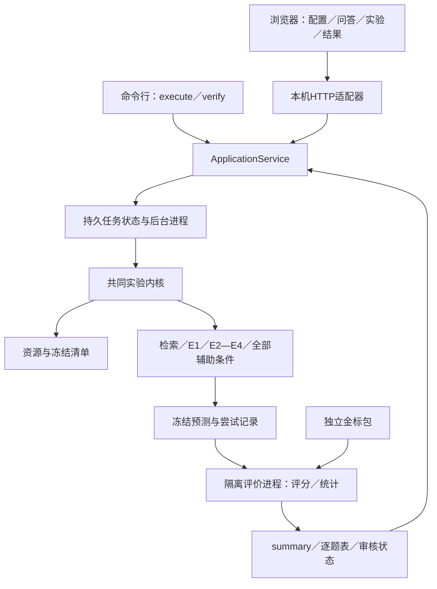

# 财报问答软件与实验内核：接口和分工设计

日期：2026-10-24。本文起草时仅形成设计；用户随后已授权实施。现行实现与验收记录见 [软件使用说明](APP_GUIDE.md) 和 [实施账本](../artifacts/software-kernel-implementation/progress.md)。当前按用户新确认先完成软件，人工核验与真实正式实验保持待办。

研究协议以[完整流程缩量方案](FORMAL_EXPERIMENT_PLAN_SCALED_20261023.md)为准；本文件确定软件怎样承载该协议，不改变样本、实验条件、重复次数、指标或统计方法。实施顺序见[实施计划](superpowers/plans/2026-10-24-software-kernel.md)。

## 1. 交付目标与范围

提供一个本机启动入口，打开浏览器后完成服务配置、资源检查、单题问答、批量实验、进度查看和结果复核。界面与命令行调用同一实验内核，正式实验直接由这套内核产生结果，不在实验结束后重新实现一套演示算法。

采用Python 3.12、FastAPI／Uvicorn、本机HTML／CSS／JavaScript界面；前端不引入Node构建链。长任务由独立后台进程执行，状态写入运行目录。FastAPI提供HTTP／静态页面，不用一次页面请求或内存中的BackgroundTasks承载整场实验。选择依据见[FastAPI后台任务说明](https://fastapi.tiangolo.com/tutorial/background-tasks/)与[服务启动说明](https://fastapi.tiangolo.com/deployment/manually/)；独立进程和文件任务存储是本项目的工程选择。

首版目标是本机课程演示与复现。运行环境先按README安装Python与依赖；API、模型名、资源位置、输出位置和实验选择随后都在界面完成。依赖已在本机Python 3.12环境解析、固定并验证；交付形态为源码与依赖清单，尚无独立安装包。首先验收当前macOS与干净的Python 3.12 Linux环境，其他系统的支持只按实际测试声明。

首版不增加账号、云部署、多人协作服务、通用PDF上传分析、OCR训练或复杂标注平台。单题演示使用已经核验的旧开发材料；正式数据仍经过既定的准备、盲核验、验证、冻结和评价隔离流程。

## 2. 不变的实验合同

| 项目 | 固定内容 |
|---|---|
| 新问题数量 | 开发50、验证50、独立主测试200、结构诊断50；辅助S50取自主200，最多350道新题 |
| 核心 | BM25与分窗MiniLM；各自E1—E4；正式与旧E1各运行一次；E2—E4各3轮真实请求 |
| 辅助S50 | D重复、L无关系索引、G旧几何、I仅图、C0无证据、C1全文、两检索器k=1／4、关闭关联、第二模型，全部保留3轮 |
| 计划生成 | 核心4,500＋辅助2,100＝6,600次，未扣除合规的同轮完全相同请求复用 |
| 新阶段次数控制 | 开发／验证最多500，重试／演示余量最多900，新阶段总尝试上限8,000；旧185次账本保留 |
| 评分与统计 | UEM为主，旧EM／F1等并列；同题先平均3轮；来源簇成对bootstrap 10,000次；四主对比98.75%区间 |
| 人工核验 | 原方案的图文范围、V2质量门槛、主S30、诊断15题、关系30区域、复核25%及争议项均保持 |

正式配置是可选的固定预设，不是可随意调整的表单。开发期选定模型、提示和资源并冻结后，正式运行只允许绑定匹配的实际资源路径和凭据；内容哈希与服务／模型配置必须满足冻结清单。改变模型、接口、样本、提示、k或重复次数会产生独立的自定义配置和运行，不能替换正式报告结果。冻结前该预设明确显示“尚未就绪”，不伪造清单哈希。

正式参数、条件枚举和计划编译只有内核持有一份；界面从能力接口获取并展示，不能在JavaScript中另写6,600的计算逻辑或自行裁减条件。单题演示、开发烟雾检查、自定义运行分别标记用途，不写入正式主表；其真实模型调用仍进入同一新阶段次数账本。

## 3. 架构与唯一入口

现已实现的默认入口为`python scripts/course_entry.py`，启动本机界面并打开浏览器；同一个脚本支持`execute --request <JSON文件>`和`verify --source-run <运行编号>`，用于自动化与教师复现。`serve --no-browser`可用于自动化；实际验证范围以实施账本为准。

程序绑定127.0.0.1，前后端同源；变更状态的请求校验本机会话与来源，避免其他网页触发付费实验。API Key不会进入命令行参数。首版每个工作区只允许一个生成／资源准备任务占有执行槽，任务内部按原协议先并发2、验证后固定4；结果阅读不占生成槽。

## 4. 两条线的接口边界

### 4.1 共同契约及所有权

`formal_src/contracts.py`定义版本1的可序列化数据结构与枚举；`app/service.py`定义应用接口，HTTP与CLI均只调用它。内核不导入`app`、FastAPI或浏览器代码。共用契约由集成负责人维护，两条线提出改动时先更新契约和对应测试，再更新各自适配器。

所有接口时间使用UTC ISO 8601，界面显示本地时区；`schema_version`固定为1。金额／费率允许未知值null，不能以0代替未知。对外错误结构统一为`code`、可读`message`、`retryable`和`blocking_items`，不返回密钥、完整请求或含金标的异常上下文。

| 结构 | 必需字段／语义 |
|---|---|
| RunRequest | `schema_version`、UUID形式`client_request_id`、`kind`、`profile_id`、`resource_set_id`、`source_run_id`、`demo_input`；后面两个可为null，按kind校验 |
| kind | `prepare`资源准备；`demo`单题问答；`experiment`批量实验；`verify`读取封存输出重算。verify必须有source_run_id，demo必须有demo_input |
| demo_input | `doc_id`、`question`、`retriever`、`groups`；仅用于演示，不能覆盖正式问题 |
| ResolvedRunSpec | RunRequest加`run_id`、用途标记、完整解析配置、代码／资源／冻结SHA、计划条目及logical_generation_count、输出相对路径；不含凭据 |
| ResourceReport | `resource_set_id`、各资源kind／注册位置／期望和实测SHA／status、`ready_for`、`blocking_items`；输入、金标、模型、审核清单分别标记 |
| PreflightReport | `ready`、`blocking_items`、`profile_hash`、`estimated_logical_generations`、`estimated_additional_attempts`、`budget_remaining`、`price_status`；不发送推理请求 |
| RunSnapshot | `run_id`、`kind`、`purpose`、`state`、`phase`、`profile_hash`、计划与完成逻辑数、在途数、attempt数、失败／弃答数、usage、最后事件序号、可用操作、时间、阻塞原因 |
| RunEvent | `schema_version`、`run_id`、递增`seq`、时间、phase、事件类型、计数与错误码。进度通道不携带问题、金标或整份请求 |
| AnswerRecord | 运行／题目／来源／检索器／模型／条件／轮次／task_id、证据冻结SHA、状态、答案／scale／citations、request_hash、attempt引用、耗时、usage、live或同轮复用来源 |
| RunResults | `run_id`、输入输出及评价版本SHA、分区和分母、按条件与轮次的指标、四主对比、工程统计、人工审核完成状态、逐题表和可用导出清单 |

RunRequest不允许任意路径、金标或API Key字段。界面先注册资源集合，服务端通过资源编号查找真实路径；verify通过已登记run_id查找结果。完整实际路径可留本机运行元数据，移机通过资源登记重新绑定，内容身份依赖相对逻辑路径与SHA，不依赖原绝对路径。

### 4.2 应用服务与HTTP映射

以下签名中结构名均见上表，`dict`内容按对应结构校验。`CredentialRef`是仅在当前服务会话有效的不透明引用。

| ApplicationService方法 | HTTP入口 | 负责什么 |
|---|---|---|
| `capabilities() -> dict` | GET `/api/v1/capabilities` | 返回模式、配置、条件定义和就绪情况 |
| `save_settings(values: dict) -> dict` | PUT `/api/v1/settings` | 保存非敏感服务／费率／输出设置；凭据字段一律拒绝；不得覆盖冻结profile中的服务与模型 |
| `save_profile(profile_id: str, values: dict) -> dict` | PUT `/api/v1/profiles/{id}` | 只修改draft／custom配置并返回版本；正式冻结后拒绝修改 |
| `clone_profile(source_profile_id: str, values: dict) -> dict` | POST `/api/v1/profiles/{id}/clone` | 生成有独立ID的custom副本，保留源profile关系，不能冒充正式配置 |
| `set_credential(api_key: str) -> CredentialRef` | POST `/api/v1/credentials/session` | 仅保存于服务进程内存；响应只返回引用 |
| `check_provider(settings: dict, credential_ref: str, level: str) -> dict` | POST `/api/v1/provider/check` | level为catalog或generation；后者计入开发账本并明确发送量 |
| `register_resources(root_path: str) -> ResourceReport` | POST `/api/v1/resources/register` | 登记本机资源目录，核对清单与SHA；界面填写路径，无需手改配置文件 |
| `check_resources(resource_set_id: str) -> ResourceReport` | GET `/api/v1/resources/{id}` | 分别检查问答／正式生成／评价／历史复核所需资源 |
| `import_reviews(resource_set_id: str, review_manifest: dict) -> ResourceReport` | POST `/api/v1/resources/{id}/reviews` | 导入已完成的图文／关系审核记录，校验身份、SHA与暴露声明 |
| `freeze_profile(profile_id: str, resource_set_id: str, model_profile_id: str | None = None) -> dict` | POST `/api/v1/profiles/{id}/freeze` | 显式采用指定custom模型方案；仅在开发／验证、预注册审核与人工门槛齐全后封存，并返回实际profile_hash |
| `preflight(request: RunRequest) -> PreflightReport` | POST `/api/v1/runs/preflight` | 检查能力、资源、冻结、次数与输入，不计入真实生成 |
| `start_run(request: RunRequest, credential_ref: str | None) -> RunSnapshot` | POST `/api/v1/runs` | 校验后登记并调度，尽快返回202；同client_request_id返回原任务 |
| `get_run(run_id: str) -> RunSnapshot` | GET `/api/v1/runs/{id}` | 从持久记录读状态 |
| `list_events(run_id: str, after_seq: int) -> list[RunEvent]` | GET `/api/v1/runs/{id}/events?after_seq=…` | 支持刷新后增量恢复；首版轮询即可 |
| `control_run(run_id: str, action: str) -> RunSnapshot` | POST `/api/v1/runs/{id}/control` | action为pause／resume／cancel；返回实际状态，未知结果需检查 |
| `get_results(run_id: str, view: str) -> RunResults` | GET `/api/v1/runs/{id}/results?view=…` | view为summary／answers／retrieval／audit，按阶段控制可见性 |
| `export_course_bundle(run_id: str) -> dict` | POST `/api/v1/runs/{id}/export` | 导出课程允许的源码／汇总／资源索引，不把私有完整快照当提交包 |

`start_run`的HTTP请求体为`{"request": RunRequest, "credential_ref": 引用或null}`；CLI从环境变量取密钥，调用同一set_credential后进入同一start_run。CLI与界面都不得自行生成第二套实验条件或统计表。

settings只保存非敏感默认值；draft profile显式采纳这些值后，check_provider验证相同设置，freeze_profile再将实际服务／模型／提示和资源身份一并封存。运行时不能从settings悄悄覆盖冻结值；本机路径和输出位置通过资源登记与设置重新绑定，不改变内容哈希。

### 4.3 后台进程与内核

后台入口为拟新增的`scripts/run_formal.py --run-dir <目录>`。任务管理器先保存ResolvedRunSpec，再通过继承环境把当前会话凭据传入进程；密钥不写入spec、事件、命令行或日志。子进程用完即释放，重启服务后要求重新填写，不承诺首版记住密钥。

`formal_src/runner.py`提供`run(spec: dict, emit: Callable[[dict], None], control: Callable[[], str], transport: Callable | None = None, *, run_dir: Path | None = None) -> dict`。spec是ResolvedRunSpec；emit接受不含seq的事件，由任务存储单点追加seq；control返回continue／pause／cancel；transport默认真实服务客户端，测试中明确注入假的返回。

`compile_run_plan(profile: dict, cohorts: dict) -> dict`由`formal_src/run_plan.py`提供：返回`units`、`logical_generation_count`、`local_baseline_count`、每个条件的预期题数／轮次与分区。完整目标应编译出6,600个逻辑生成单元、正式E1与旧E1合计1,000个本地结果单元，以及本地检索参数工作。请求复用减少实际调用，不减少比较表的逻辑记录。

runner按kind分派prepare／demo／experiment／verify；这些模式共用证据、检索、回答和输出代码。评价另起只读金标的进程：推理进程只获得输入包的资源引用和SHA，不获得金标位置或内容；推理封存前不生成测试得分或挑选错题。

## 5. 持久状态、恢复与真实进度

运行状态限定为queued、validating、blocked、running、pause_requested、paused、cancel_requested、cancelled、interrupted、completed、failed。phase独立描述prepare／review／freeze／retrieval／generation／scoring／statistics／audit。completed只表示该kind的程序任务完成；实验的人工审核未完成时`audit_complete=false`，不能显示“全部课程验收通过”。

- 双击开始或网络重发：同client_request_id只登记一个run_id；想重做实验必须显式建立新任务，不能覆盖原目录。
- 暂停／取消：停止派发新请求，已发送请求尽量收尾并保存；在途清空后才显示paused／cancelled。取消保留已产生的费用与输出，不能把部分样本当完整主表。
- 浏览器刷新／关闭：后台继续；恢复页面读取run_id和after_seq，不依赖浏览器内存。
- 服务或后台进程崩溃：重新启动时检查进程与锁。无活进程的任务标interrupted；已完成的task_id不再发送，在途结果未知的attempt单列待检查，不能假定未发送后自动补发。
- 恢复时先复核profile、代码、资源和已保存输出哈希。只有未发送任务或符合原协议的一次传输／服务重试可继续；合法回答、弃答、拒绝、解析或截断结果不因分数而重做。
- 单个真实attempt在发送前持久预留，后追加结果；工作区锁统一控制新阶段8,000次数。旧账本只读关联。不同轮次禁止缓存复用，同轮完全相同服务与完整payload的复用记录来源。
- 失败超过原协议滚动阈值、凭据无效、模型不匹配或资源变化时blocked；由界面显示具体原因并提供检查后恢复，不自动换模型或缩小实验。
- 进度分开显示逻辑生成完成数、真实attempt、重试和复用。剩余时间只作估计；未知费率显示“费用未知”，usage和调用次数照常显示。

## 6. 资源、盲核验与界面行为

界面保留“配置与资源、问答演示、运行实验、结果复核”四个区域。

配置与资源区域填写接口、模型和本次会话密钥，显示PDF／OCR／模型权重／审核清单的状态；提供公开资源获取说明、准备任务和本地目录登记。模型发现和服务连通不等于图文／schema兼容，通过真实generation检查时明确记入开发次数。费用采用实际渠道费率，未知可继续但不能伪填0。

资源准备可自动获取和生成审核材料；人工作业仍由盲核验人员完成。界面导入签有审核者身份、时间、资产SHA及暴露声明的记录，展示未完成项。首版不开发通用标注器，也不把自动脚本状态当人工批准。测试核验工作包不显示对应问题、金标或模型输出；看过相应QA的人不能补写该测试描述。

问答演示默认旧开发材料，允许修改演示问题并比较E1／E2，条件具备时展示E3／E4；明确标注预实验方法或正式方法版本。无需密钥可运行E1；缺少图文／结构能力时展示缺项，不用缓存假装新推理。正式测试推理尚未封存时不开放测试逐题结果，以免界面成为边看分边调参入口。

实验页面先preflight，再显示本次运行的固定方案、预计调用、缺项和输出位置。全部就绪后点击开始即运行完整方案；人工门槛未齐全时说明缺什么并定位到资源页面。界面不能把“开始”解释为已经完成数据核验、模型兼容或人工错误分析。

结果页面从内核输出读取主200、诊断50、S50辅助、每轮、数值／单位、引用、usage与错误状态；显示已有历史运行与新生成的区别。历史预实验按旧指标和分母原样展示，不套新UEM改写旧成绩。verify无API，只重算封存预测；仍提供execute真实重做能力，不把二者混同。

## 7. 文件边界与分工

人员姓名和工时按真实参与补填。这里的A／B／C是责任角色，不代表已经安排人员或启动子任务。

| 角色 | 独占修改区域 | 责任与交接 |
|---|---|---|
| A：外壳与集成 | `app/`、`web/`、`scripts/course_entry.py`、`requirements-app.txt`、`tests/app/`、当前README入口 | HTTP／CLI、服务配置、任务持久化与后台进程、进度／结果页面；维护共享契约，接入B，不实现实验算法或重新算分 |
| B：实验方法与执行 | `formal_src/`中除evaluation／statistics／audit外模块、`formal_config/`、`scripts/run_formal.py`、`tests/formal/`对应测试 | 新数据、统一扩展、分窗、E1、V2、完整矩阵、provider／次数账本／恢复；先提供确定性测试返回，再提供真实内核 |
| C：独立评价与验收 | `formal_src/evaluation.py`、`statistics.py`、`audit.py`、`course_export.py`、`tests/acceptance/`、课程提交清单 | 保管隔离金标、UEM与统计、盲法和人工审核、CLI／UI一致性、干净环境与课程包核验 |

`formal_src/contracts.py`由A协调、B／C共同核对；首次提交后接口改动只由维护者合并，其他人不并发修改。C拥有评价／审核，B只通过契约使用；A调用C的导出服务，不另写课程打包逻辑。2人时可兼任工程责任，但不得兼任已暴露QA的盲描述审核。没有独立合格审核者时明确未满足启动门槛，不以软件权限代替人的盲法。

现有`src/`、`scripts/llm_execution.py`、`scripts/multimodal_jobs.py`及旧结果继续冻结。旧函数可以只读引用；正式修改写入新目录并记录版本，不修改旧执行器的200次硬限来冒充新阶段调度。当前不是Git仓库，计划不初始化Git，不制造commit；实施时每个里程碑记录文件SHA与验证记录。

## 8. 新增模块职责与产物

| 路径（均为拟新增） | 单一职责 |
|---|---|
| `formal_src/contracts.py`、`run_plan.py` | 共用数据合同；把冻结profile和cohort编译为任务清单 |
| `formal_src/data_protocol.py`、`evidence.py`、`structure.py` | 新来源隔离与输入／评价包、统一证据与关联、问题盲V2 |
| `formal_src/retrieval.py`、`baseline.py` | k=1／2／4与分窗检索；正式／旧E1适配 |
| `formal_src/provider.py`、`runner.py` | 服务请求与持久尝试控制；统一执行全部模式与阶段 |
| `formal_src/evaluation.py`、`statistics.py`、`audit.py` | 评分、成对统计、人工核验清单及汇总 |
| `formal_src/course_export.py` | 课程专用投影与≤50MB打包，资源／密钥不入包 |
| `app/service.py`、`jobs.py`、`resources.py`、`api.py` | 应用门面、进程与状态、资源登记、HTTP适配 |
| `web/index.html`、`app.js`、`styles.css` | 四区域界面，渲染服务端状态与指标 |
| `formal_config/formal-v1.json` | 原方案的全部样本、条件、重复、指标与次数设置；冻结前状态标draft |
| `scripts/course_entry.py`、`scripts/run_formal.py` | 唯一启动／CLI入口；后台worker入口 |

新运行放`artifacts/formal-v1/runs/<run_id>/`，包含`spec.json`、`state.json`、`events.jsonl`、`tasks.jsonl`、`predictions.jsonl`、`retrieval.jsonl`、`summary.json`、`results.csv`及冻结清单。输入图文与金标不混入进度事件，实际请求和响应按资源等级保存。全部attempt另写新阶段`artifacts/formal-v1/budget.jsonl`，跨任务共用，引用旧185次账本。

状态与summary原子写入，事件和尝试追加写入；文件锁保护单执行槽及全局预算。重算结果新建verify运行，引用源运行，不覆盖旧summary。课程导出只收允许的源码、测试、依赖、汇总和资源索引；原私有工程快照继续按其已有用途保留，不直接提交。

## 9. 接入顺序与验收标准

1. **先定合同与测试返回。** A先有能显示完整状态流的界面，B先有能编译完整计划的内核；测试返回只标“软件测试”，不进入正式报告。
2. **尽早接一道真实题。** 使用旧开发材料打通界面→同一service→runner→BM25／E1／真实E2→持久输出；计费纳入阶段账本，不新建临时例外。
3. **并行补齐正式方法。** B实现全部研究方法，C建立评分、审核与统计；A完善资源、恢复和结果展示。软件界面不阻挡方法开发，命令行始终可走同一service。
4. **开发／验证贯通后冻结。** 原方案的全部输入、质量、兼容、次数和吞吐门槛通过后才运行正式测试；界面具备基本启动／监控即可，不等待全部美化。
5. **同一内核运行正式矩阵并封存。** C随后评价、审核与复核；A对接真实输出完成验收材料。

验收至少包括：双击不重复发请求；刷新恢复进度；中断后不重发已完成请求；密钥不出现在磁盘输出；未完成运行不能产生完整主表；全部条件和三轮不缺项；CLI与界面同配置的确定性测试结果一致；已封存真实预测的两种入口重评分一致；新目录和干净环境可按README运行；正式报告的每个关键数可追到run_id与文件。

生成模型具有随机性，因此CLI与界面一致性用同一封存预测／确定性测试transport核对，不要求两次真实请求逐字相同。真实接口另做小量开发验证，正式三轮按既定协议观察波动。

## 10. 排期与尚未完成的工作

沿用原方案的一周窗口：10月24日完成接口／分工／计划；10月25日争取贯通开发链路并达到原18:00冻结目标；正式生成目标仍为10月27日前结束；28日分析，29日干净环境／录屏／课程包，30日20:00内部提交目标，任务书截止24:00。

上述是目标而非完成承诺。关键路径在新数据资格、V2、正式E1、调度和独立评价；两条线不能完全解耦，至少在合同、首题、冻结和最终结果四次集成。未达到冻结门槛时报告实际阻塞，不通过减题、减轮、删辅助组或跳过审核赶日期。

设计交付时只证明接口与计划可审阅；该历史阶段尚未实现新软件。后续已经实施共用内核与工作台、准备候选资料，并验证本机本地编码器；当前实际进度见实施账本。真实正式生成、人工核验、实际渠道费率与课程验收仍未完成，本设计文件本身不证明这些结果。

## 实施接口补充（2026-10-24）

输出工作区设置在下次启动生效，原结果不迁移；CLI显式`--workspace`优先。`capabilities`返回当前工作区与已保存模型方案。`freeze_profile`显式接收`model_profile_id`，不会选取最近修改的配置；正式配置还绑定预注册审核计划SHA。

输入推理封存与评分产物证明分开保存。`result-proof.json`绑定汇总及实际存在的逐题/检索文件；复核重新检查来源、任务与资源身份。后续人工语义审核以独立的SHA记录绑定，不改写生成时资源清单。课程包包含实际冻结配置与必要运行说明，使用独立课程README。
