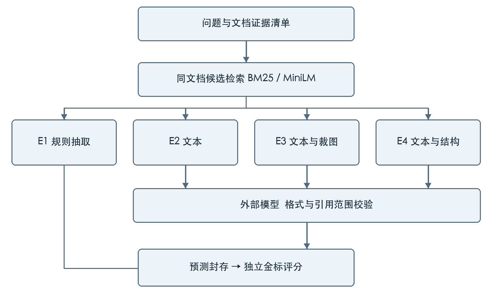

# 财报证据检索与受约束问答

**课程**：自然语言处理（2026—2027 秋季学期）　**组长学号 / 姓名**：【待你填写】　**方向**：A 领域 RAG 问答

**成员与分工**：【待你填写；此前按要求省略】

**提交日期**：【待你填写】　**仓库地址**：【待你填写】　**演示录屏**：【待你填写】

> 本文件按[官方项目报告模板](templates/项目报告模板_20261013_codex.md)迁移。本目录保留官方模板副本；原 DOCX/PDF 和封存实验结果保留在本地。**【待你填写】**表示需要你提供的真实信息或自己的分析；**【待核验】**表示已有材料但仍需实际检查。所有标记处理完再导出提交版；当前 Markdown 尚未重新排成课程要求的 8—12 页 PDF。

### 你还需要完成什么

- [ ] 摘要：写 200—300 字，最后一句使用你自己的分析结论。
- [ ] ① 写具体使用场景、价值和原先的成功判据。
- [ ] ② 补方案优缺点与选型理由，回答为什么用 RAG、为什么不微调。
- [ ] ④ 核实实际硬件与环境，补提示模板/配置定位。
- [ ] ⑤ 写主结果、参数对比和至少三个课程原理点的解释。
- [ ] ⑥ 核对三个失败案例的原始证据，填归因和改进。
- [ ] ⑦ 核实账单、实际数据许可，补其他 AI 工具和人工修改情况。
- [ ] ⑧ 填真实成员与分工；每人另填一份[个人贡献声明表](个人贡献声明表.md)。
- [ ] 附录 A：在拟提交的环境验证命令；补录屏、仓库链接，检查最终 PDF 页数和提交包。

## 摘要

**【待你填写】200—300 字。** 可直接使用的事实：财报证据问答；200 道 span 题、40 个来源；BM25/MiniLM 检索；E1 规则与 E2 文本、E3 文本加图、E4 文本加结构；最高主集 UEM 为 MiniLM/E3 的 36.83%，对应 F1 为 54.01%。UEM 为本项目自定义单位敏感评分，不等同于人工语义准确率。请在完成第⑤、⑥节后独立概括结论。

## ① 问题定义与背景

### 任务范围

项目面向需要定位英文财报原文的学习者，输入一条问题及其对应文档，系统在同一文档的证据片段内检索，再输出答案、数量级字段、证据引用或弃答状态。财报中同一指标可能同时出现多个年度和不同单位；仅返回一个字符串不足以说明依据，需要将回答与原始证据标识关联。

本次已完成的数据范围是 200 道 span 类型问题，来自 40 个财报来源。问题形式包括日期、金额、业务描述和条款文本。本次不包含算术、多跳计算等题型的验证，因此任务范围是限定文档内的证据检索与回答，不是完整的金融推理或投资决策。

### 输入输出契约

| 对象 | 实际记录内容 |
| --- | --- |
| 问题 | question_id、doc_id、question；推理投影不含答案 |
| 证据 | evidence_id、文本、文档及页面关联；图片和结构按清单解析 |
| 回答 | answer、scale、citations、status |
| 追溯 | task_id、request_hash、attempt_refs、provenance |
| 评估 | 独立金标、逐条得分、分组指标、封存身份 |

检索候选限定为问题指定的 doc_id，不能把结果解释为跨全部财报的开放域检索。模型返回的 citations 是证据标识；标识存在和属于输入范围可以由程序验证，但这不等同于人工确认每个引用都充分支持答案。

### 目前可核查的任务规模

主运行保存 4400 条输出，其中 800 条为本地 E1 与 E1_legacy 基线，3600 条为 E2、E3、E4 两种检索器各三轮的逻辑生成。已有独立复算记录验证任务覆盖、评分和来源聚类 bootstrap；这里的“完成”指计划结果和评分文件齐全，不代表课程的个人贡献、费用和分析写作已经完成。

> **【待你填写】** 用自己的语言说明目标用户的一项具体使用场景、为什么这个问题值得做，以及事先设定的成功判据。区分“程序能运行”“答案有依据”和“指标改善”三个层次；不要事后用最高分倒推原定目标。

## ② 相关工作与方案选型

TAT-DQA 将财报页面中的文本、表格和版面信息结合起来，原论文介绍了 3067 页文档和 16558 个问答对 [1]。本项目使用其中经过本地整理的子集，既没有复现论文完整训练流程，也没有沿用其官方榜单评分；下文成绩只属于本地 financial_uem_v1 协议。

检索增强生成将外部证据接入语言模型回答过程。Lewis 等人的 RAG 工作讨论参数化模型与非参数化检索记忆的结合 [2]。本系统使用外部 API 和固定提示构造输入，没有实现论文中的联合微调训练。Sentence-BERT 使用可按余弦相似度比较的句向量 [3]；本系统用本地 MiniLM 编码器作为密集检索分支。

| 路径 | 本项目实现 | 可检查的差别 |
| --- | --- | --- |
| BM25 | 词项匹配与长度归一化 | finance 分词；k1=1.5，b=0.75 |
| MiniLM | 本地 CPU 句向量检索 | 192-token 窗口，步长160，窗口最大相似度 |
| E1 | 规则抽取，不调用生成模型 | 候选不足或相互冲突则弃答 |
| E2 | 检索文本与受约束生成 | 返回答案、scale、引用和状态 |
| E3 | 文本与证据裁图 | 增加视觉输入 |
| E4 | 文本与结构表达 | 增加结构输入；不叠加 E3 图片 |

E1_legacy 保存旧规则比较器，主结果表使用正式 E1。两者的 UEM 在本次主集相同，但并非所有辅助指标都相同，因此不能把两个版本合并为一次运行或声称实现完全一致。E2—E4 共用检索和问题身份，便于追踪证据表示的变化。

### 替代方案的记录范围

本轮没有进行 SFT、LoRA、微调分类器、交叉编码器重排或第二生成模型实验。配置中虽列有辅助条件和 secondary 模型，它们不属于本次 main_only 运行。可在方案讨论中介绍这些技术，但不能把未执行的备选方案写成对照结果。

> **【待你填写】** 独立解释选择规则基线、BM25、MiniLM 和三种证据表示的理由；回应为什么在本项目条件下使用 RAG，以及为什么没有选择微调。用预算、数据和目标约束说明取舍，并说明哪些选择是运行前作出的。

### 按官方模板补齐选型依据

| 备选方案 | 优点 | 缺点 | 本项目是否采用 | 理由 |
| --- | --- | --- | --- | --- |
| 无检索的纯提示 | 【待你填写】 | 【待你填写】 | 未作为独立对照运行 | 【待你填写】 |
| RAG（检索后回答） | 【待你填写】 | 【待你填写】 | 已采用 E2—E4 | 【待你填写】 |
| LoRA / SFT 微调 | 【待你填写】 | 【待你填写】 | 未采用、未运行 | 【待你填写】 |

**【待你填写】** 为什么本项目选择 RAG、没有选择微调？结合实际数据、资源和目标写出依据，勿将未运行方案描述为已有实验结论。

## ③ 系统设计



图 1  主运行的数据流。金标仅在预测封存后进入评分；架构图概括实际模块，不表示使用了联合训练。

数据层区分 inference、evaluation 与资源清单。推理入口拒绝含金标的对象；检索记录保留完整候选标识、候选得分和所选 top-k。证据组装按注册标识解析路径并校验内容身份，避免把 evidence_id 当作文件名。

运行层负责冻结计划、准备检查点、并发调用、重试和恢复。任务主键包含题目、检索器、条件、模型角色和轮次。只有相同轮次、相同请求身份的结果可按记录复用；三轮本身仍分别生成，不能把复用计成新的独立模型调用。

评分层先核对输出任务集合与计划完全一致，再载入独立金标，输出 scored-answers.jsonl 和 summary.json。网页是任务配置、运行观察和证据查看入口，核心结果仍以磁盘上的计划、尝试和预测记录为准。

## ④ 实现细节

### 检索与规则抽取

formal_src/retrieval.py 首先筛选相同 doc_id 的证据，按 evidence_id 排序形成确定性候选集。BM25 调用词项检索实现；同分时按 evidence_id 排序。正式配置 k=2，接口同时支持 k=1 与 k=4，但支持某个值不代表本次已经运行该参数。

MiniLM 编码器通过本地目录加载，设置 local_files_only=True、trust_remote_code=False 和 device=cpu；编码时归一化向量。长证据默认拆为 192-token 窗口、步长 160，取各窗口与查询的最大余弦相似度。查询超过已验证预算会报错，不能默默截断后继续标作完整输入。

formal_src/baseline.py 将问题与所选文本交给规则候选生成。正式规则默认最小分数 0.5、歧义间隔 0.15；当存在分数相近但答案或 scale 不同的候选时弃答。唯一的文本数量级声明可用于补充 scale。旧 legacy 分支单独保留方法版本。

### 证据与回答边界

E2 使用文本；E3 使用文本和可定位裁图；E4 使用文本和结构。它们的区别是输入表示，不是每一步累加所有模态。生成输出必须满足预定格式与引用范围要求。数据清单负责证据与页面的关联，结构身份检查只对当前运行需要的输入范围执行。

| 关键点 | 实现证据 | 可复查的行为 |
| --- | --- | --- |
| 输入隔离 | data_protocol.py / contracts.py | 金标不能进入推理对象 |
| 检索 | retrieval.py | 同文档候选；确定性排序 |
| 规则基线 | baseline.py | 低置信与冲突候选弃答 |
| 证据身份 | evidence.py / structure.py | 按清单解析与校验 |
| 评分 | evaluation.py | 全计划覆盖后评分 |

依赖文件记录 macOS arm64 的 CPython 3.12 环境，包含 FastAPI、Uvicorn、PyMuPDF、sentence-transformers、transformers 和 torch 等。报告记录的是仓库锁定依赖；未在本次报告编写过程中重新安装全部环境或进行跨平台验收。

### 恢复与调用可靠性

主运行中出现过准备阶段耗时长、usage 缺失、传输异常和断网后的恢复。历史记录保存各次备份、身份迁移与验证日志。准备优化将全包校验移到 worker 启动时，在逐题检索中只使用原有同文档候选；准备缓存绑定代码、输入、配置和任务身份，并原子落盘。

课程模式对可重试传输或解析失败最多额外重试两次，间隔为 2 秒和 4 秒；每次尝试仍计入调用数。失败耗尽后保存失败输出，其他任务可以继续；鉴权、配置和调用额度等保护保留。恢复时保留已完成预测及尝试引用，不把失败历史擦除。

并发由 1 调整为 4 后，保存了首批四请求的有界探测结果。准备进度、已保存数和最近进展通过事件展示。进程还活着不能证明任务在推进，因此运行界面将实际事件和保存结果作为状态证据。

| 最终执行事实 | 数量 | 口径 |
| --- | --- | --- |
| 逻辑生成 | 3600 | 含直接生成和同轮复用 |
| 直接生成记录 | 2844 | provenance=live |
| 同轮同请求复用 | 756 | provenance=same_round_reuse |
| 本地基线 | 800 | E1 和 E1_legacy |
| 物理调用尝试 | 2920 | 包含重试 |
| 技术失败尝试 | 77 | 不是最终失败题数 |
| 最终生成状态 | 3372 / 226 / 2 | 回答 / 弃答 / 失败 |

两条最终失败共享同一次早期 usage_missing 尝试，分别属于同题的 BM25 E2 和 MiniLM E2。后续断网没有导致计划输出缺行。封存摘要中的 engineering.reuse_count=0 未覆盖跨恢复全程；本稿按 predictions.jsonl 的 provenance 复算为 756，未改写原封存文件。

历史全量回归在有界重试修复时记录 341 项、339 通过、2 项可选跳过；断网恢复随后有 14 项针对性检查。这里引用历史软件验证记录，不把它们当作新的课程录屏、人工审核或当前设备完整复测。

**【待核验】** 实际硬件型号、内存与软件版本；当前记录为 macOS arm64 / CPython 3.12，MiniLM 使用 CPU，生成模型使用外部 API。**【待你填写】** 对照实际冻结配置与源码，补提示模板及配置文件位置；学习率、LoRA 秩在本次未训练方案中不适用。

## ⑤ 评估

### 数据与固定协议

主集为 200 题、40 个财报来源，全部 answer_type=span；准备记录包含 145 个文档页和 927 个证据片段。主集与开发、验证按来源标识和 PDF 内容身份进行隔离。金标按 question_id 对齐 source_id，答案原值保留；推理投影不载入金标。

本次仅运行 main_only：两种检索器、四个核心方法及 legacy 规则比较器。E1 每题一次；E2—E4 每题三轮，使用返回标识为 gpt-6.1-sol 的外部模型。该标识来自代理响应，未独立验证代理底层模型。辅助诊断、消融与第二模型未运行。

主指标 financial_uem_v1 是自定义单位敏感精确评分。数值答案检查数值和单位；其他答案使用归一化精确匹配，不进行同义理解或单位换算。EM 与 token F1 为并行指标。所有计划题保留在分母中，弃答和失败不被筛掉；先平均每题的重复轮次，再对 200 题平均。

| 条件 | BM25 UEM % | MiniLM UEM % | BM25 F1 % | MiniLM F1 % |
| --- | --- | --- | --- | --- |
| E1 | 8.50 | 8.00 | 6.84 | 6.34 |
| E2 | 32.50 | 34.67 | 52.89 | 52.92 |
| E3 | 34.33 | 36.83 | 54.16 | 54.01 |
| E4 | 34.50 | 36.33 | 54.80 | 53.78 |

表 1  主集原始汇总；F1 是项目评分器的 token 重叠口径，不是人工语义准确率。E3 为文本加图片，E4 为文本加结构。

| 预先登记比较 | 差值 pp | 95% 区间 pp | 98.75% 区间 pp |
| --- | --- | --- | --- |
| P1 bm25/E2 − bm25/E1 | 24.00 | [16.42, 32.30] | [14.43, 34.68] |
| P2 minilm/E2 − bm25/E2 | 2.17 | [-1.68, 6.14] | [-2.67, 7.21] |
| P3 bm25/E3 − bm25/E2 | 1.83 | [-1.17, 4.79] | [-2.00, 5.70] |
| P4 bm25/E4 − bm25/E2 | 2.00 | [-1.51, 5.36] | [-2.66, 6.21] |

区间以 40 个来源为聚类重采样单位，重复 10000 次，随机种子 20261023；不是将 600 条生成记录当作 600 个独立样本。表中同时提供普通和四项比较对应的调整区间。

> **【待你填写】** 独立解释主表与区间支持哪些结论、哪些结论不能支持。比较 E1 与 E2 时讨论规则覆盖差异；比较 E2、E3、E4 时同时检查区间与各轮波动，不只读取最高点估计。

### 历史开发集参数对比

以下记录来自 nonllm-phase2/final-v5/development，执行时间早于本次主运行。每个配置有 12 道开发题，只有 11 题具备经核验且非空的支持块映射，因此检索命中与回答正确的分母不同。模型调用为零，比较的是检索与旧 E1 抽取，不是生成模型的 top-k 消融。

| 配置 | 检索命中 | E1 正确 | E1 回答 |
| --- | --- | --- | --- |
| BM25 finance k=1 | 8/11 | 5/12 | 7/12 |
| BM25 finance k=2 | 11/11 | 8/12 | 10/12 |
| BM25 simple k=2 | 10/11 | 7/12 | 9/12 |
| MiniLM k=1 | 8/11 | 5/12 | 7/12 |
| MiniLM k=2 | 11/11 | 8/12 | 10/12 |

表 2  旧开发集参数与分词记录。正确数采用旧 strict answer+scale EM；不得与表 1 的 UEM 拼接比较。原始计数见 RAW_COUNTS.csv 和各配置 metrics.json。

finance k=1 与 k=2 构成 top-k 参数对比，simple k=2 与 finance k=2 构成分词配置对比。它们提供真实开发阶段证据，但没有单独隔离主运行的所有实现变化，也不能证明 k=2 对其他数据规模或生成模型最优。原始 run.json 与 metrics.json 应与汇总表同时保留。

### 课程原理与自己的证据

| 原理点 | 可用证据 | 需由学生解释的问题 |
| --- | --- | --- |
| 分词和词表选择 | 表2 simple/finance，10/11与11/11 | 哪道题的词项改变了排序；数字与符号如何处理 |
| RAG 召回与引用 | 表2 k1/k2，8/11与11/11 | 新增证据是否覆盖答案；为何命中不等于回答正确 |
| 评测协议选择 | 表1 UEM/F1；第六节单位与边界案例 | 如何区分格式不匹配、单位不一致和实际答错 |

这三组证据可以支持课程原理讨论，但仅列概念或分数并不满足“用自己的实验解释”的要求。尤其是检索支持映射不足的题，不能自动视为未命中，也不能用未经人工核验的引用代替召回真值。

> **【待你填写】** 围绕表2独立写参数结论，并从对应 retrieval.jsonl 中选择至少一题核对排序变化；分别为三个原理点写出“观察到什么、为什么可能如此、证据的限制”。若使用事后分析，清楚说明时间与范围。

### 官方模板中的延迟与花费栏

主指标已见上方主表。下表补充算术平均耗时，按检索器和条件分别统计 `provenance=live` 且 `elapsed_ms` 有效的生成记录；可能包含重试，不是端到端单题耗时。未将同轮复用记录作为新调用计入。

| 方案 | 指标 1：UEM % | 指标 2：token F1 % | 平均延迟（s） | token 花费 |
| --- | --- | --- | --- | --- |
| bm25 / E1 | 8.50 | 6.84 | 未统一计量 | 0（不调用生成 API） |
| bm25 / E2 | 32.50 | 52.89 | 18.31（n=468） | 未完整记录；账单待核验 |
| bm25 / E3 | 34.33 | 54.16 | 20.34（n=470） | 未完整记录；账单待核验 |
| bm25 / E4 | 34.50 | 54.80 | 19.53（n=464） | 未完整记录；账单待核验 |
| minilm / E1 | 8.00 | 6.34 | 未统一计量 | 0（不调用生成 API） |
| minilm / E2 | 34.67 | 52.92 | 18.49（n=480） | 未完整记录；账单待核验 |
| minilm / E3 | 36.83 | 54.01 | 20.26（n=478） | 未完整记录；账单待核验 |
| minilm / E4 | 36.33 | 53.78 | 19.27（n=484） | 未完整记录；账单待核验 |

参数对比 A/B 使用上方旧开发集 k=1 / k=2 的真实记录：无生成 API token 花费，延迟未在本稿统一统计。其旧 strict EM 与主集 UEM 不是同一评分协议，因此单独保留原表。

## ⑥ 错误分析与局限

下面将已有三例按官方表格迁入。观察到的差异已填；归因与改进留给你查阅引用证据后填写。

| # | 失败样例（输入 → 输出） | 归因（数据 / 模型 / 提示 / 检索 / 评测口径） | 可能的改进 |
| --- | --- | --- | --- |
| 1 | When did the Executive Chairman join the company? → joined us in September 2004；标准答案：September 2004；预测 scale=空，标准 scale=空；UEM=0 | 【待你填写】 | 【待你填写】 |
| 2 | What is the company's R&D expenses in 2018? → $124.0 million；标准答案：$128.0 million；预测 scale=million，标准 scale=空；UEM=0 | 【待你填写】 | 【待你填写】 |
| 3 | How much would the company have to pay up to as defined in the severance agreements as of December 31, 2019 following a triggering event in the company? → approximately $6.4 million；标准答案：approximately $6.4 million；预测 scale=million，标准 scale=空；UEM=0 | 【待你填写】 | 【待你填写】 |

### 查阅这三例的证据

- 案例 1：`question_id=2dd79a8ac5c10a3031ab106e1e71ccc8`；bm25/E2 第 1 轮；引用 `f8461def9377282156f1f43b3a398048:p1:u004`。
- 案例 2：`question_id=08c5f8534afff6baa6321ffab462cdca`；bm25/E2 第 1 轮；引用 `37473f9bf2eb2527e2b1b0ad47fadc02:p1:u009`。
- 案例 3：`question_id=083ac2b6f7dd309304d8b51124854c00`；minilm/E4 第 1 轮；引用 `e030fe0652b64e86f10167ec63291ee0:p1:u002`。

案例三 `gold_numeric=false`，走非数值 span 评分路径。可观察差异为 scale 字段，不能写成金额计算错误。完整记录见案例副本（本地证据，不随源码公开）。

> **【待你填写】** 逐例打开引用证据，独立判断问题出在检索覆盖、字段选择、生成边界、数据标注还是评分协议；每例给出证据与可执行改进。请勿仅凭最终字符串断言模型“幻觉”或检索失败。

全体生成记录中，有 66 条归一化回答正文与金标完全相同，但在单位或 scale 约束下 UEM 仍为 0。这一计数不是人工确认正确的 66 条，不能直接加回准确率。原始冻结分数保留；如后续添加语义审核或规范化评分，应单独标明为事后敏感性分析。

覆盖局限包括：仅有 span 题；只有 40 个来源；代理底层模型未独立验证；引用语义支撑未完成人工审核；未运行诊断、第二模型和主集 top-k 消融。需要学生结合任务目标说明这些限制如何影响可推广范围。

## ⑦ 工程与伦理

### 调用量与延迟

主运行实际发起 2920 次物理尝试，其中 77 次为技术失败尝试。756 条同轮请求复用不重复计为物理调用。运行中断、准备、暂停和恢复均有独立记录，因此从启动到完成的总墙钟时长不适合直接作为模型响应时间。

| 条件 | live记录数 | 中位数 s | P95 s |
| --- | --- | --- | --- |
| E2 | 948 | 13.93 | 47.90 |
| E3 | 948 | 15.61 | 49.34 |
| E4 | 948 | 14.04 | 50.34 |

表 3  仅对 provenance=live 且 elapsed_ms 有效的记录统计；P95 用最近秩法。该字段可能含重试耗时，是记录级耗时，不是纯模型推理延迟。

渠道单价、账单与完整 token 费用未提供；运行后期按用户要求仅统计调用次数，不要求 usage。费用栏须由成员依据真实渠道账单填写，不可把公开官方定价套用于代理渠道。**【待核验】** 单价、计费单位、总花费或账单估算、取数日期；无法获得完整 token 记录时如实注明缺失。

### 数据与外部服务

数据来自公开财报问答资料，外部 API 仅应接收已经确认允许使用的公开证据。API Key 不应写进源码或报告；本稿不包含密钥。提交包仍需单独检查凭据、个人隐私、虚拟环境、模型权重和数据集，不能因为运行成功就视为提交检查完成。

TAT-DQA 官方仓库 README 标示数据集采用 CC BY 4.0 [4]；论文摘要则提及 non-commercial use [1]。本稿保留这两处来源的具体差异。提交者需按实际下载版本核对随附许可、署名与分发范围，不把代码许可自动等同于所有原始财报的许可。

当前结果面向课程技术评估，不能作为金融建议。引用校验仅验证范围，未证明回答具有业务决策所需的充分性。第六节的金额错误必须在演示和分析中保留，不能只挑正确样例展示。AI 辅助范围见本节；设计与分析仍需学生自主完成。

### AI 使用声明

工具：Codex。报告草稿使用环节：读取课程任务书与现有源码、整理封存结果、提取案例、生成架构图与文档排版、生成并检查 PDF。没有为本报告补跑外部模型，没有改写封存成绩。

验证方式：正文数字对应原始 summary.json、predictions.jsonl、scored-answers.jsonl、attempts.jsonl 及派生 analysis.json；旧参数表对应独立开发阶段 metrics.json。图表只使用现有记录。文档另经渲染逐页检查。

**【待你填写】人工修改部分：**实验设计理由、主结果解释、三个原理点的论证和逐例错误归因必须由学生独立撰写；成员应说明自己如何核验 AI 整理内容、修正了什么，以及仍有哪些未核实信息。此前开发过程的其他 AI 工具和使用范围须按真实情况补充。


## ⑧ 分工与贡献

| 学号 | 姓名 | 负责模块 | 产出证据（文件 / 提交记录 / 实验） | 工作量占比 |
| --- | --- | --- | --- | --- |
| 【待你填写】 | 【待你填写】 | 【待你填写】 | 【待你填写】 | 【待你填写】% |

> 按实际人数增行；总占比为 100%。本表须与每人单独提交的《贡献声明表》一致。此前用户要求暂省略成员信息，本次不推定谁完成了哪些工作。

### 可供核对的项目产出

| 产出类别 | 已有证据位置 | 成员应补充 |
| --- | --- | --- |
| 实现 | formal_src/、src/ragpilot/、app/、web/ | 本人负责范围及具体修改 |
| 正式结果 | 主run的spec、predictions、scored-answers、summary | 运行组织、核验和异常处理贡献 |
| 历史对比 | nonllm-phase2/final-v5/development | 实验设计与实际执行责任 |
| 过程记录 | development-demo-repair/MAIN_RUN_20261026.md | 本人参与环节与工作量 |
| 课程材料 | 本草稿及后续人工修订 | 独立写作范围、录屏与成员声明 |

本人应将“使用 AI 辅助”与“自己负责和理解”同时写清：例如是否提出任务、检查代码、执行实验、定位异常、核查数字或独立解释结果。不能将 AI 生成内容全部计为本人独立撰写，也不应只写“大家共同完成”而缺乏可核查证据。


## 附录

### A. 复现指南

环境：Python 3.12；应用依赖见仓库 `requirements-app.txt`，MiniLM 依赖见 `requirements-encoder-runtime.txt`。需保留完整结果工作区，并登记与原实验内容身份一致的资料；只有源码和聚合分数不足以复核全部结果。详细操作见[应用指南](../APP_GUIDE.md)。

在 `rag-pilot` 根目录、依赖与资料已就绪的情况下，用以下命令复核已有结果（不会重新调用生成模型）：

```sh
.venv-app/bin/python scripts/course_entry.py --workspace artifacts/formal-v1 verify --source-run 48defb1b-508a-4fa9-9158-cd92dfc8de16
```

预期：命令退出码 0，输出状态 JSON 中 `state` 为 `completed`。这是复核已有预测，不是重新执行所有推理。**【待核验】** 提交者在拟提交环境实际执行并记录输出；本次模板迁移只核对了命令入口，未启动复核任务。其他机器的虚拟环境名称或资源登记位置可能不同。

### B. 代码结构说明

```text
rag-pilot/
├── scripts/course_entry.py     网页启动、运行与复核 CLI
├── formal_src/                 正式实验内核
│   ├── retrieval.py            同文档检索
│   ├── baseline.py             E1 规则抽取
│   ├── evidence.py             证据身份与资源解析
│   ├── runner.py               实验执行
│   ├── retry_policy.py         重试策略
│   └── evaluation.py           金标评分
├── src/ragpilot/               原有检索与开发阶段实现
├── app/                        应用服务、运行状态与工作区
├── web/                        前端
├── tests/                      自动化验证
└── artifacts/                  已有运行、结果和过程证据
```

### C. 关键运行日志与迭代记录

主运行：`artifacts/formal-v1/runs/48defb1b-508a-4fa9-9158-cd92dfc8de16/`。

已保存证据：4400 条计划输出齐全；3600 条逻辑生成与 800 条本地基线；2920 次物理尝试。完整历史见主运行记录（本地证据，不随源码公开）。

下面是已有断网恢复验证日志的原文片段，不是本次迁移新跑的测试：

```text
Ran 14 tests in 0.152s

OK
```

来源：network-resume-tests.log（本地证据，不随源码公开）。有界重试、并发与准备缓存的迭代证据集中在 `artifacts/development-demo-repair/`，对应第④节；个人应补充自己参与的日期、具体修改及可定位记录。

以下路径均相对于 rag-pilot 项目根目录。主运行目录为 artifacts/formal-v1/runs/48defb1b-508a-4fa9-9158-cd92dfc8de16/。用任务主键定位单条预测，再按 question_id 查独立金标；不要仅凭截图抄写分数。

| 证据 | 内容 |
| --- | --- |
| spec.json | 冻结配置与4400项计划；execution_scope=main_only |
| sealed.json / result-proof.json | 封存与结果证明 |
| predictions.jsonl | 回答、引用、轮次、来源和调用引用 |
| scored-answers.jsonl / results.csv | 逐条评分与导出 |
| summary.json | 分组指标及四项主比较 |
| attempts.jsonl | 2920次物理尝试及失败记录 |
| artifacts/main-result-analysis/analysis.json | 独立复算结果、来源哈希和评分 caveat |
| artifacts/nonllm-phase2/RAW_COUNTS.csv | 旧开发集参数计数 |
| artifacts/course-report-draft/case-evidence.json | 三个原始案例的预测、金标与分数副本 |

### 核心身份

predictions.jsonl SHA256
817c9076f2e909be7196defc8db1e15301c0c872a8a3764f351fd717d1b58df9

scored-answers.jsonl SHA256
a80cd3ab1b2b441d35e4af14202ccde7b9a63afd6336d059525408e4356ce23f

主表的 UEM 和 F1 由封存 summary.json 直接读取；区间由 analysis.json 中的 comparisons 读取；延迟由原预测的 live 记录派生。所有原文件保持原位，草稿和衍生图片只写入 course-report-draft。


### D. 数据来源与许可说明

数据来自 TAT-DQA 的本地整理子集；许可差异和使用边界见第⑦节。**【待核验】** 实际下载版本的许可文件、署名要求及提交包允许包含的数据范围。

### 参考资料


[1] Zhu F. 等. Towards Complex Document Understanding By Discrete Reasoning. ACM MM 2022.
https://arxiv.org/abs/2207.11871

[2] Lewis P. 等. Retrieval-Augmented Generation for Knowledge-Intensive NLP Tasks. NeurIPS 2020.
https://arxiv.org/abs/2005.11401

[3] Reimers N., Gurevych I. Sentence-BERT: Sentence Embeddings using Siamese BERT-Networks. EMNLP-IJCNLP 2019.
https://aclanthology.org/D19-1410/

[4] NExTplusplus. TAT-DQA 官方数据集仓库及许可说明.
https://github.com/NExTplusplus/TAT-DQA

[5] Sentence Transformers. Computing Embeddings 官方文档.
https://www.sbert.net/examples/sentence_transformer/applications/computing-embeddings/README.html

网页核对日期：2026-10-26。课程规范依据本地《自然语言处理》课程项目任务书.html 正文；未将页面脚本或样式作为课程要求。
